> **AI-assisted project:** AI tools helped with documentation, code review, and implementation. Design decisions, tradeoffs, and validation results are documented for technical discussion.

# Multi-Carrier Shipping — Designing for Failure

A modular-monolith Canadian domestic shipping platform demonstrating resilient multi-carrier rate aggregation, idempotent external shipment creation, capability-aware recovery, and microservice-ready module isolation.

**Java 17 · Spring Boot 3.2 · Spring JDBC · ANSI SQL / SQLite · Resilience4j · Micrometer · HTML5 / CSS3 / Vanilla JavaScript**

## Quick Navigation

- **[System Component Architecture & Module Boundaries](docs/design/module-boundaries.md)** — Full English component design, governing principles (**Unidirectional Dependency, ADP, DIP, Published Contracts**), Mermaid & ASCII architecture diagrams, hexagonal intra-module layering, and microservice extraction blueprint.
- **[Backend Technical Design](docs/design/backend-design.md)** — Domain invariants, idempotency state machines, 4-table ANSI SQL schema, and failure recovery design.
- **[Application API Contract](docs/design/application-api.md)** — REST endpoints, 2-hour fingerprint-bound guest authentication, and structured error envelopes.
- **[Acceptance & E2E Test Report](docs/summaries/acceptance-test-report.md)** — Verification evidence across 103 backend unit/integration/architecture tests, Playwright Chromium E2E tests, and live ShipTime Sandbox verification.

---

## 1. System Module Architecture

The codebase is organized by vertical **business bounded contexts** (`auth`, `quote`, `booking`, `reconciliation`), an isolated external protocol layer (`provider.sandbox`), a deployment composition root (`runtime`), and a reusable technical foundation (`shared`). Cross-module communication occurs **exclusively through published `contract` interfaces** (`quote.contract.QuoteSelectionPort`, `booking.contract.ShipmentRecoveryPort`), enforced on every build by [`ModuleBoundariesTest`](src/test/java/com/enterprise/shipping/shipping/ModuleBoundariesTest.java).

```mermaid
flowchart TB
    subgraph Client["Browser Client (Single-Screen 3-Tab Workstation)"]
        UI["HTML5 / CSS3 / Vanilla JS\n(Guest Token + 24h Draft + Carrier Progress)"]
    end

    subgraph WebBoundary["HTTP Security & Diagnostics Boundary"]
        Trace["shared.api\nShippingRequestTracingFilter\nShippingExceptionHandler"]
        AuthFilter["auth.infrastructure\nShippingAuthenticationFilter"]
    end

    subgraph BusinessModules["Vertical Business Bounded Contexts (Modular Monolith)"]
        direction LR

        subgraph AuthMod["auth Module"]
            AuthAPI["auth.api\nShippingAuthController"]
            AuthApp["auth.application\nGuestSessionTokenService"]
        end

        subgraph QuoteMod["quote Module"]
            QuoteAPI["quote.api\nShippingQuoteController"]
            QuoteApp["quote.application\nQuoteApplicationService"]
            QuoteContract["quote.contract\nQuoteSelectionPort"]
            RatePort["quote.port\nRateComparisonPort"]
            SingleEngine["quote.application\nSingleProviderRateEngine"]
            FanOutEngine["quote.application\nHighFanOutAggregationEngine"]
            QuoteStore["quote.infrastructure.persistence\nJdbcQuoteStore"]
            QuoteBridge["quote.infrastructure.provider\nSandboxRateAdapter"]
        end

        subgraph BookingMod["booking Module"]
            BookAPI["booking.api\nShippingBookingController"]
            BookApp["booking.application\nShipmentApplicationService\nShipmentRecoveryService"]
            BookContract["booking.contract\nShipmentRecoveryPort\nManualReviewReason"]
            BookDomain["booking.domain\nShipmentBooking"]
            BookStore["booking.infrastructure.persistence\nJdbcShipmentStore"]
            BookBridge["booking.infrastructure.provider\nSandboxShipmentAdapter\nSandboxLabelAdapter"]
        end

        subgraph ReconMod["reconciliation Module"]
            ReconApp["reconciliation.application\nPendingShipmentDiscovery"]
            ReconStore["reconciliation.infrastructure.persistence\nJdbcPendingTaskStore"]
            ReconBridge["reconciliation.infrastructure.provider\nSandboxRecoveryAdapter"]
        end
    end

    subgraph RuntimeRoot["Deployment Composition Root"]
        Runtime["runtime\nSandboxConfiguration"]
    end

    subgraph ProviderLayer["External Provider Protocol Layer"]
        ProviderClient["provider.sandbox\nSandboxProviderClient\nSandboxPayloadMapper"]
    end

    subgraph SharedKernel["shared Technical Foundation & Value Kernel"]
        SharedDomain["shared.domain\nShippingIntent / ShippingAddress\nShippingMarketPolicy / ShippingException"]
        SharedHttp["shared.infrastructure.http\nOutboundOperation / OutboundCallExecutor\nOutboundDeadline / CarrierHttpClientFactory"]
        SharedDB["shared.infrastructure.persistence\nShippingMigrations / UniqueConstraints\nSqliteDataSources"]
        SharedIdentity["shared.identity\nUserContext / TimeOrderedIds"]
    end

    subgraph Storage["Isolated Module Tables (ANSI SQL)"]
        QDB[("shipment_requests\nshipment_quotes")]
        BDB[("shipment_bookings")]
        RDB[("booking_reconciliation_tasks")]
    end

    UI --> Trace --> AuthFilter
    AuthFilter --> AuthAPI --> AuthApp
    AuthFilter --> QuoteAPI --> QuoteApp
    AuthFilter --> BookAPI --> BookApp

    BookApp ==>|"Contract Call Only"| QuoteContract
    QuoteApp -.->|"implements"| QuoteContract
    ReconApp ==>|"Contract Call Only"| BookContract
    BookApp -.->|"implements"| BookContract

    QuoteApp --> RatePort
    SingleEngine -.->|"implements"| RatePort
    FanOutEngine -.->|"implements"| RatePort

    QuoteApp --> QuoteStore --> QDB
    BookApp --> BookStore --> BDB
    ReconApp --> ReconStore --> RDB

    SingleEngine --> QuoteBridge
    BookApp --> BookBridge
    ReconApp --> ReconBridge

    QuoteBridge --> ProviderClient
    BookBridge --> ProviderClient
    ReconBridge --> ProviderClient
    Runtime -.->|"wires"| ProviderClient

    ProviderClient --> SharedHttp
    QuoteStore --> SharedDB
    BookStore --> SharedDB
    ReconStore --> SharedDB
```



---

## 2. Core Engineering Pillars

### 2.1 Rate Comparison: Idempotent Snapshots & Dual Rate Strategies
- **Idempotent Rate Requests (`QuoteApplicationService`):** Persists canonical customer shipping intent (`Idempotency-Key` + SHA-256 `content_fingerprint`) before invoking external rate providers. Supports safe replays, version-fenced retries on failed/expired quotes, and read-only status inspection (`GET /api/quotes/{requestId}`).
- **Pluggable Rate Engines (`RateComparisonPort`):**
  - `SingleProviderRateEngine`: Queries a multi-carrier shipping aggregator (`SandboxProviderClient`) in a single bounded call.
  - `HighFanOutAggregationEngine`: Performs scatter-gather fan-out across direct carrier adapters (`CarrierRatePort`) with per-carrier `ThreadPoolExecutor` isolation, Resilience4j bulkheads/circuit breakers, and monotonic deadline cancellation.

### 2.2 Shipment Creation: Claim-Before-Call & Safe Recovery
- **Durable Claim-Before-Call (`ShipmentApplicationService`):** Commits a short transaction inserting a `PENDING` booking claim guarded by `UNIQUE(user_id, idempotency_key)` and `UNIQUE(user_id, request_id)` prior to any external HTTP POST.
- **Explicit State Machine (`ShipmentBooking`):** Enforces legal transitions across `PENDING`, `CONFIRMED`, `FAILED`, `PENDING_INQUIRY`, and `MANUAL_REVIEW`.
- **Capability-Aware Reconciliation (`PendingShipmentDiscovery`):** Scans overdue unresolved bookings via `ShipmentRecoveryPort` using keyset pagination, evaluates provider lookup capabilities via `RecoveryCapabilityPort`, registers deduplicated `PAUSED` tasks, and escalates unrecoverable bookings to `MANUAL_REVIEW` without ever re-POSTing a chargeable shipment creation.

### 2.3 Portable Persistence & Zero-Join Data Isolation
- **Four Application Tables (`db/shipping/V001..V004`):** `shipment_requests`, `shipment_quotes`, `shipment_bookings`, and `booking_reconciliation_tasks` (plus `schema_migrations`).
- **RDBMS-Agnostic ANSI SQL:** Uses standard `VARCHAR`, `DECIMAL(12,4)`, `BIGINT`, composite indexes, explicit column projections (zero `SELECT *`), and portable SQLState/vendor unique-constraint detection (`UniqueConstraints`).

---

## 3. Run and Verify

```sh
# Run all 103 backend unit, SQLite persistence, concurrency, and architecture boundary tests
./mvnw test

# Run Playwright headless Chromium end-to-end browser journey
./mvnw test -Pbrowser-tests
```

### Code Entry Points
- **Architecture Fitness Tests:** [`ModuleBoundariesTest`](src/test/java/com/enterprise/shipping/shipping/ModuleBoundariesTest.java)
- **Quote Module:** [`ShippingQuoteController`](src/main/java/com/enterprise/shipping/quote/api/ShippingQuoteController.java) · [`QuoteApplicationService`](src/main/java/com/enterprise/shipping/quote/application/QuoteApplicationService.java) · [`SingleProviderRateEngine`](src/main/java/com/enterprise/shipping/quote/application/SingleProviderRateEngine.java) · [`HighFanOutAggregationEngine`](src/main/java/com/enterprise/shipping/quote/application/HighFanOutAggregationEngine.java)
- **Booking Module:** [`ShippingBookingController`](src/main/java/com/enterprise/shipping/booking/api/ShippingBookingController.java) · [`ShipmentApplicationService`](src/main/java/com/enterprise/shipping/booking/application/ShipmentApplicationService.java) · [`ShipmentBooking`](src/main/java/com/enterprise/shipping/booking/domain/ShipmentBooking.java)
- **Reconciliation Module:** [`PendingShipmentDiscovery`](src/main/java/com/enterprise/shipping/reconciliation/application/PendingShipmentDiscovery.java) · [`RecoveryCapabilityPort`](src/main/java/com/enterprise/shipping/reconciliation/port/RecoveryCapabilityPort.java)
- **Auth Module:** [`ShippingAuthController`](src/main/java/com/enterprise/shipping/auth/api/ShippingAuthController.java) · [`GuestSessionTokenService`](src/main/java/com/enterprise/shipping/auth/application/GuestSessionTokenService.java) · [`ShippingAuthenticationFilter`](src/main/java/com/enterprise/shipping/auth/infrastructure/ShippingAuthenticationFilter.java)
- **Provider & Shared Transport:** [`SandboxProviderClient`](src/main/java/com/enterprise/shipping/provider/sandbox/SandboxProviderClient.java) · [`OutboundOperation`](src/main/java/com/enterprise/shipping/shared/infrastructure/http/OutboundOperation.java) · [`OutboundCallExecutor`](src/main/java/com/enterprise/shipping/shared/infrastructure/http/OutboundCallExecutor.java)
