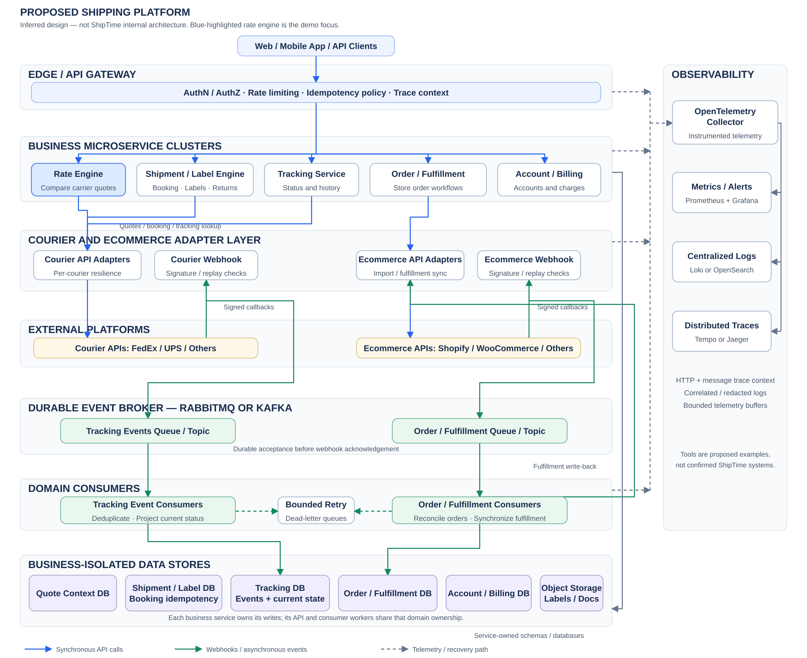
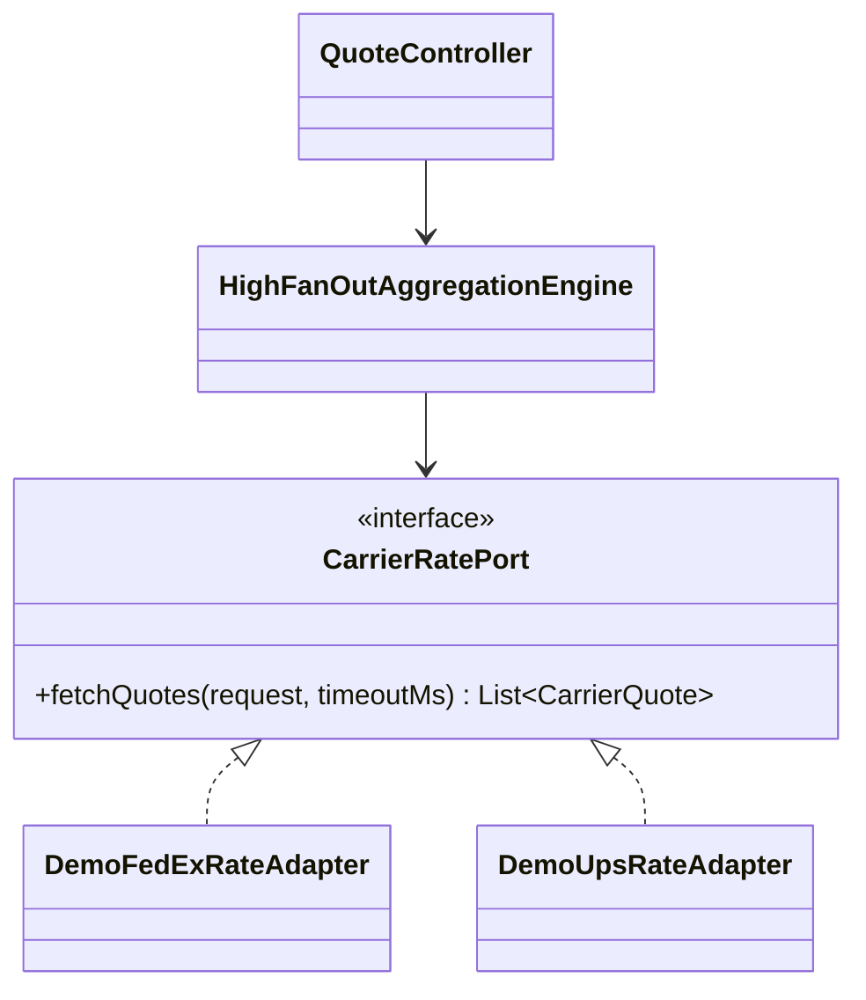

> **AI-assisted project:** AI tools helped with product research, documentation, code review, and implementation. Design decisions, tradeoffs, and validation results are documented for discussion.

# Multi-Carrier Shipping — Engineering Case Study

**Business understanding → technical challenges → architecture → implementation**

## 1. Business & Product

ShipTime connects businesses and ecommerce stores with multiple shipping carriers through one platform.

- **Rate comparison:** compare shipping prices and delivery options, including negotiated account rates.
- **Labels & documents:** create shipping labels and prepare shipment documentation.
- **Ecommerce integration:** connect stores to shipping and fulfillment workflows.
- **Tracking:** give merchants and customers visibility across carriers.
- **Bulk shipping:** process multiple orders with less manual work.

## 2. Key System Technical Characteristics & Difficulties

*Scenarios and numbers below are illustrative engineering assumptions, not measurements of ShipTime's production systems. These are possible technical approaches; the demo implements rate comparison and a local shipment-booking workflow.*

### 2.1 High Fan-Out Rate Engine (P99 Latency & Timeout Control)

**Problem:** A rate request might fan out to **8–12 eligible carrier endpoints**. Carrier A responds in **200 ms**, while Carrier B's legacy SOAP endpoint takes **4,000 ms** or times out. Waiting for every result exposes the request to the slowest dependency and amplifies tail latency.

- **Fan-out / scatter-gather:** execute calls concurrently using asynchronous I/O or virtual threads. With 12 independent calls each meeting a latency threshold 99% of the time, the probability that all meet it is only **0.99¹² ≈ 88.6%**—illustrating why dependency P99 does not translate into aggregate P99. At **100 quote requests/second × 12 carriers**, this generates **1,200 outbound calls/second** before retries, making outbound capacity planning essential.
- **Global timeout budget:** for an illustrative **1.5-second response budget**, allocate per-carrier deadlines within the remaining time and reserve time for aggregation. Return available quotes with explicit missing-carrier outcomes; measure aggregate P99 and result completeness together.
- **Bulkhead isolation:** isolate each courier’s outbound capacity using per-courier concurrency limits and dedicated connection pools or enforceable per-destination connection limits. A slow or failing courier must not exhaust connections needed by healthy couriers. Bound admission waits, configure connection and response timeouts, and cancel outstanding work where supported; virtual threads alone do not provide this isolation.

Technical basis: [timeouts and retry amplification](https://aws.amazon.com/builders-library/timeouts-retries-and-backoff-with-jitter/) · [Resilience4j bulkheads](https://resilience4j.readme.io/docs/bulkhead). The probability calculation assumes independence; real dependency latencies may be correlated.

### 2.2 Multi-Carrier Abstraction & Integration Fragility

**Problem:** Carrier APIs differ in protocols (**REST / SOAP**), payload formats (**JSON / XML**), authentication, units, service definitions, charge breakdowns, and error semantics.

- **Adapter pattern:** isolate each carrier behind `CarrierRatePort`, mapping requests and responses to a canonical domain model. Normalize units and preserve currency, pricing context, and known charge components so quotes are meaningfully comparable.
- **Circuit breakers:** use a per-carrier breaker, such as **Resilience4j**, to reject calls after configured failure/slow-call thresholds and minimum sample counts are reached; permit limited recovery probes in the half-open state. Bulkheads separately limit concurrency.
- **Contract tests:** verify translation and failure handling against representative payloads and sandbox contracts. Bound retries for safe transient failures by the remaining request budget, with backoff and jitter when appropriate.

Technical basis: [Resilience4j circuit breaker behavior](https://resilience4j.readme.io/docs/circuitbreaker) · [safe, bounded retries](https://aws.amazon.com/builders-library/timeouts-retries-and-backoff-with-jitter/).

### 2.3 Shipment Booking — Idempotency & Outcome Reconciliation

**Problem:** A carrier may create a shipment and a financial obligation, but its response can be lost or time out. A merchant retry can then create a duplicate shipment or charge. A timeout means the booking outcome is unknown, not necessarily failed.

- **Durable idempotency:** scope a client request key to its account and operation; enforce database uniqueness and persist request identity, booking state, and result. Return the recorded result for repeated requests and reject reuse of a key with a different payload.
- **Booking-state management:** distinguish `PENDING`, `CONFIRMED`, `FAILED`, and `UNKNOWN` outcomes. Persist the booking attempt before the outbound call, and retain enough context to investigate interrupted requests.
- **Outcome reconciliation:** resolve uncertain bookings using carrier-supported idempotency tokens, booking references, or lookup before retrying. Local deduplication alone cannot guarantee exactly-once remote booking. Keep unresolved cases recoverable through background checks or operator intervention, with shipment and charge records linked for investigation.

Technical basis: [idempotent API design](https://aws.amazon.com/builders-library/making-retries-safe-with-idempotent-APIs/) · [timeouts do not prove side effects failed](https://aws.amazon.com/builders-library/timeouts-retries-and-backoff-with-jitter/). ShipTime's [cancellation and refund rules](https://support.shiptime.com/en/support/solutions/articles/42000053479/) confirm the business lifecycle; the recovery design above is an illustrative approach.

### 2.4 High-Volume Webhook Processing & Real-Time Tracking Updates

**Problem:** Tracking traffic is bursty rather than evenly distributed. During the **morning depot scan and dispatch peak**, many parcels may be scanned as received, loaded, or out for delivery within a short window, producing a concentrated burst of carrier updates. Webhooks or polling can also deliver duplicated, delayed, or out-of-order events—for example, `DELIVERED` arrives before an older `IN_TRANSIT` event.

**Illustrative capacity estimate:** **100,000 active shipments × 10 updates/day = 1 million events/day**, averaging approximately **12 events/second**. If morning scans generate **100,000 events in 5 minutes**, ingestion reaches approximately **333 events/second—29× the daily average**. This is a sizing example, not measured ShipTime traffic; carrier batching or retries can make short bursts sharper.

- **Event-driven ingestion:** use **Kafka or RabbitMQ** to buffer scan-peak bursts and decouple webhook acceptance from database writes. Acknowledge webhooks only after durable acceptance; scale consumers against queue lag and processing throughput while bounding concurrency to protect the database. Include failed-event recovery.
- **Idempotent consumers:** expect redelivery. Deduplicate using carrier event IDs or a documented event identity, and commit processing before acknowledging queue messages. A broker does not eliminate duplicate business effects.
- **State-aware projection:** preserve event history and derive current status using event time and valid transitions. A late `IN_TRANSIT` update should not overwrite `DELIVERED`; returns, exceptions, corrections, and multi-package shipments require explicit rules.

Technical basis: [RabbitMQ reliability, acknowledgements, and redelivery](https://www.rabbitmq.com/docs/reliability). Actual carrier delivery guarantees and event identities must be verified per integration.

## 3. A Possible System Architecture

One possible system architecture inferred from ShipTime’s public product information, not a description of its internal systems. Rate aggregation and shipment booking are implemented as local demos. Click the diagram to view it full-size.

[](docs/design/platform-architecture.svg)

## 4. Implementation Focus: Rate Comparison

**Goal:** collect quotes from multiple carriers within a time budget and return available results with carrier failures clearly identified.

The module implements the following core techniques:

- **Concurrent aggregation — Java 17:** bounded per-carrier `ThreadPoolExecutor` instances and `ExecutorCompletionService` implement fan-out / scatter-gather, with immediate overload rejection.
- **Deadline control & graceful degradation:** monotonic global and per-carrier deadlines, transport timeouts, and cooperative task cancellation bound waiting time while preserving available quotes.
- **Carrier abstraction — Adapter pattern:** a common `CarrierRatePort` interface isolates carrier-specific protocols and payloads from aggregation logic.
- **Circuit breakers — Resilience4j:** independent per-carrier breakers reject calls when failure or slow-call thresholds are reached; half-open probes test recovery.
- **Bulkhead & connection isolation:** per-carrier semaphore bulkheads, bounded workers, and dedicated Reactor Netty connection pools prevent one failing courier from exhausting others' capacity. Local admission rejection is kept outside breaker failure accounting.
- **Monitoring — Spring AOP, Micrometer & Prometheus:** `@MonitorCarrierApi` and `@Around` advice separate transport timing and error classification from adapter logic. Micrometer exposes latency histograms and capacity/outcome metrics through Prometheus. `QuoteObserver` keeps aggregation metrics outside the engine; recording failures do not change comparison outcomes.

The class structure below shows the core implementation boundaries.



## 5. Implementation Focus: Shipment Booking

- **Durable idempotency:** SQLite unique owner/key claims, structured business fields, and normalized request fingerprints prevent duplicate initial submissions and reject changed intent.
- **Short atomic writes:** Spring JDBC commits the claim before calling the carrier; no database transaction spans the HTTP request.
- **Recovery without blind retries:** stable carrier references, inquiry-only reconciliation, and business-version guards and independently leased recovery tasks recover uncertain outcomes across restarts. Successful bookings create no recovery task.
- **Domain behavior:** `ShipmentBooking` owns receipt validation and lifecycle transitions; application services coordinate carrier calls and persistence. Metrics use a failure-isolated observer port.

[Core and demo boundaries](docs/design/runtime-boundaries.md) · [Shared code organization](docs/design/code-organization.md) · [Booking design](docs/design/booking-sqlite.md) · [Recovery module](docs/design/reconciliation.md) · [Run the booking demo](docs/runbooks/booking-demo.md)

## 6. Run & Results

**Requirements:** JDK 17. The demo profile supplies simulated couriers and a fixed local owner; core workflows depend on ports. Market rules, currency, carrier availability, and server-side fault modes come from configuration.

```sh
./mvnw test
./mvnw spring-boot:run -Dspring-boot.run.profiles=demo
```

In another terminal, request a comparison:

```sh
curl -sS http://127.0.0.1:8080/api/shipping/quotes \
  -H 'Content-Type: application/json' \
  -d '{"originPostalCode":"L6K 3V3","destinationPostalCode":"M5V 2T6","weight":1,"weightUnit":"KG","dimensionUnit":"CM","length":10,"width":10,"height":10}'
```

**Verified results:** all **90 tests pass**. Packaged demo checks produced:

| Scenario | HTTP / Status | Result |
| --- | --- | --- |
| Both couriers available | `200 / COMPLETE` | Three quotes sorted by price: CAD 16.20, 17.00, 18.50 |
| FedEx times out | `200 / PARTIAL` | UPS quote retained; FedEx marked `TIMEOUT` |
| Both couriers fail | `502 / FAILED` | Explicit comparison failure; no quotes |

To reproduce the timeout scenario, stop the application and restart it with:

```sh
./mvnw spring-boot:run -Dspring-boot.run.profiles=demo \
  -Dspring-boot.run.arguments="--demo.quote-carriers.fedex-mode=slow"
```

Metrics: `http://127.0.0.1:9091/actuator/prometheus`.

[Booking API and restart recovery](docs/runbooks/booking-demo.md) · [Rate demo scenarios](docs/runbooks/demo.md) · [Recorded responses](docs/summaries/demo-smoke-results.json) · [Recovery validation](docs/summaries/reconciliation-separation.md) · [Storage validation](docs/summaries/structured-booking-storage.md) · [Boundary validation](docs/summaries/runtime-boundaries.md) · [Domain validation](docs/summaries/booking-domain.md) · [Refactor validation](docs/summaries/structure-refactor.md) · [Booking validation](docs/summaries/booking-sqlite.md) · [Rate validation](docs/summaries/java17.md)

---

**Product references:** [ShipTime](https://shiptime.com/) · [Shipping API](https://shiptime.com/shipping-api/) · [Account rates](https://shiptime.com/bring-your-own-courier-rates/) · [Bulk shipping](https://shiptime.com/shiptime-updates-features/revamped-ecommerce-shipping/)
