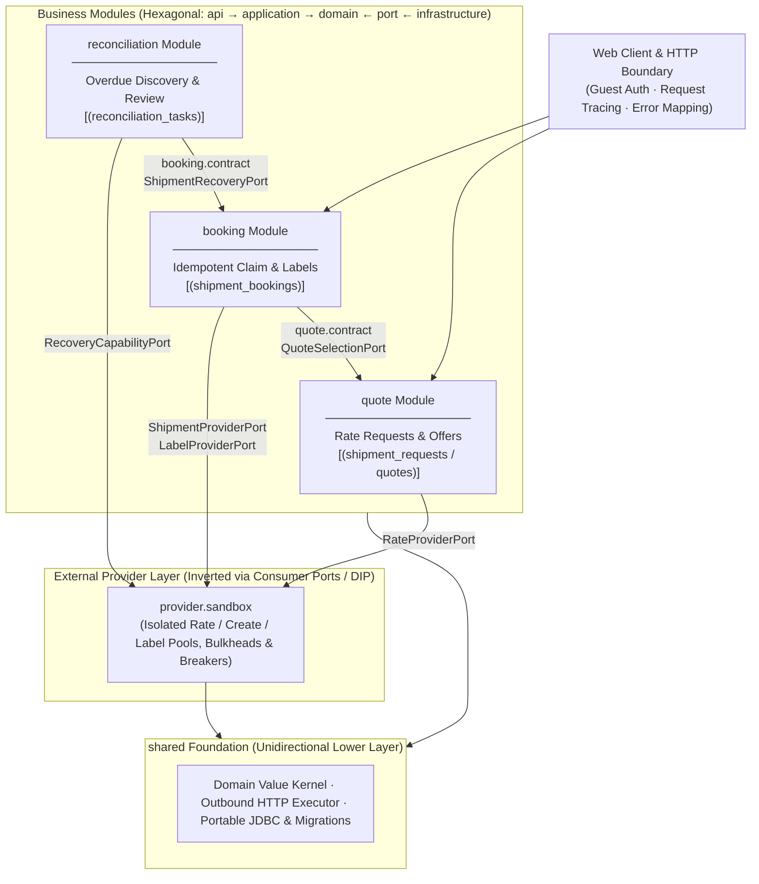

> **AI-assisted project:** AI tools helped with documentation, code review, and implementation. Design decisions, tradeoffs, and validation results are documented for technical discussion.

# Multi-Carrier Shipping — Designing for Failure

An independent Canadian domestic shipping application demonstrating bounded tail latency on reads, idempotent external writes, and strict modular boundaries. The web workflow compares live carrier quotations, selects an exact offer, books a shipment under a durable claim, and retrieves its printable PDF label.

**Java 17 · Spring Boot 3.2 · Spring JDBC · ANSI SQL / SQLite · Resilience4j · Micrometer · HTML5 / CSS3 / Vanilla JavaScript**

[System Architecture & Module Boundaries](docs/design/module-boundaries.md) · [Backend Technical Design](docs/design/backend-design.md) · [Frontend API Contract](docs/design/application-api.md) · [Acceptance & E2E Test Report](docs/summaries/acceptance-test-report.md) · [Delivery Plan](docs/iterations/delivery-plan.md)

**Delivery status:** Iterations I1–I8, single-screen 3-Tab workstation UI, backend API/SQLite/concurrency/architecture fitness tests (**103 passing tests**), Playwright headless Chromium E2E browser acceptance, and live end-to-end verification against the external ShipTime Sandbox are complete.

---

## 1. Rate Comparison: Bound Tail Latency and Prevent Thread Starvation

### Problem Scenario & Capacity Math (Little's Law)

In the current production flow, the external **Sandbox API Provider is a multi-carrier aggregator**: one `POST /rest/rates` call collects tariffs across Canada Post, Purolator, FedEx, UPS, DHL, Canpar, and Loomis (`collection-seconds = 30s`, `rate-timeout = 90s`). **While this aggregator model eliminates application-side multi-carrier fan-out on the sandbox path**, its upstream collection window introduces a severe **Little's Law ($L = \lambda \times W$)** thread-exhaustion hazard:

- **Single-aggregator saturation math:** Each instance runs a bounded Tomcat pool of **`64` worker threads** (`192` threads across a 3-node cluster). When upstream rate aggregation averages $W = 16\text{ s}$ (and spikes to $30\text{ s}$ on tail calls), an unguarded node is **100% thread-exhausted at just $\lambda = 64 / 16\text{ s} = 4\text{ RPS}$** (or **$2.1\text{ RPS}$** at $30\text{ s}$ tail latency; **$6.4\text{ RPS}$** across a 3-node cluster).
- **Read-starves-write amplification:** Because rate browsing typically outnumbers shipment checkout by **10:1 to 20:1**, a burst of just **8–10 concurrent rate requests**—or a few impatient users clicking "Get Rates" repeatedly—would pin every servlet thread and HTTP connection, starving revenue-critical `POST /api/bookings` and label downloads.
- **Direct-carrier fan-out math (`HighFanOutAggregationEngine`):** When the `quote` module is wired to direct carrier adapters (`CarrierRatePort`) at **100 RPS × 12 carriers = 1,200 outbound calls/s**, a single degraded carrier stalling at **4,000 ms** (while healthy carriers respond in **200 ms**) demands $100 \times 4\text{ s} = 400$ concurrent threads, cascading across the JVM if pools are shared.

### Architectural Response

- **Operation-isolated bulkheads & connection pools (`OutboundOperation`):** `SandboxProviderClient` provisions physically separate Reactor Netty connection pools, zero-wait semaphores (`maxWaitDuration = 0`), and circuit breakers per operation: `rates` is capped at **`read-concurrency = 8`**, `create` at **`create-concurrency = 4`**, and `labels` at **`read-concurrency = 8`**. Even if slow rate calls completely saturate all 8 rate slots (rejecting excess rate requests in **< 1 ms** with `503 PROVIDER_CAPACITY_EXCEEDED`), **56 of 64 Tomcat threads (87.5%) and 100% of booking capacity remain unblocked**.
- **Idempotent request coalescing & version-fenced retries (`QuoteApplicationService`):** Before any network call, the service commits a canonical `shipment_requests` snapshot guarded by `UNIQUE(user_id, idempotency_key)` and a SHA-256 `content_fingerprint`. Duplicate in-flight clicks immediately return `202 Accepted` (`RATING`) without consuming a second provider slot. Failed (`RATE_FAILED`) or expired (`QUOTES_EXPIRED`) requests advance `rate_version` via Compare-And-Set (`WHERE rate_version = ? AND state = ?`) to retry safely under the same `request_id`.
- **Monotonic deadlines & dual rate engines (`RateComparisonPort`):** `OutboundDeadline` enforces monotonic `System.nanoTime()` budgets covering both header wait and body streaming, while a 50% failure rate over 10 calls trips the operation's `CircuitBreaker` for `10s`. Behind `RateComparisonPort`, `SingleProviderRateEngine` handles the sandbox aggregator, while `HighFanOutAggregationEngine` remains built into `quote` with per-carrier `ThreadPoolExecutor` (`SynchronousQueue`) isolation and cooperative cancellation for direct-carrier deployments.

---

## 2. Shipment Creation: Preserve Financial Correctness Across Uncertain Outcomes

### Problem Scenario & Contention Math

`POST /rest/shipments` is a **chargeable financial side effect** with an upstream timeout budget of `create-timeout = 60s`. Two failure modes threaten correctness and availability:

1. **Database connection pool deadlock under slow I/O:** The local SQLite/JDBC pool is bounded to **`4` connections** (`busy_timeout = 3,000 ms`) to serialize WAL writers safely. If a booking transaction held a JDBC connection across a `15s–60s` external HTTP POST, **just 4 concurrent bookings ($\lambda < 0.2\text{ RPS}$)** would exhaust the entire database pool, causing all quote reads and status checks across the node to fail after `3,000 ms`.
2. **Ambiguous network failure & double-charging:** A provider can accept and bill a shipment at $t = 10\text{ s}$, after which the TCP connection drops or times out before the HTTP response reaches the application. Treating a timeout or `5xx` as a failed creation—and retrying automatically in the browser, HTTP client, or backend—would dispatch a second `POST /rest/shipments` and **double-charge the customer**.

### Architectural Response

- **Zero-I/O transactions (`Propagation.NEVER` + two-phase short commits):** `ShipmentApplicationService` never holds a database transaction across network I/O. Phase 1 commits a `PENDING` booking claim in **< 2 ms** and releases the JDBC connection; the external HTTP POST runs outside any transaction (`create-concurrency = 4`); Phase 2 records the outcome in **< 2 ms** using a version-fenced CAS update (`WHERE booking_id = ? AND version = ?`). Holding each DB connection for ~4 ms instead of ~20,000 ms increases database connection throughput capacity by **> 5,000×**.
- **Dual uniqueness arbitration:** `UNIQUE(user_id, idempotency_key)` guarantees same-key replays return the existing booking without re-dispatching, while `UNIQUE(user_id, request_id)` prevents two different browser tabs or keys from booking two quotes belonging to the same shipment request (`409 SHIPMENT_ALREADY_SUBMITTED`).
- **Explicit aggregate state machine (`ShipmentBooking`):** Enforces legal transitions across `PENDING`, `CONFIRMED`, `FAILED` (`422` definitive carrier rejection), `PENDING_INQUIRY` (`202` ambiguous network outcome), and `MANUAL_REVIEW`, validating receipt invariants before mutation.
- **Why ambiguous bookings escalate to `MANUAL_REVIEW` (missing provider guarantees):** Resolving an unknown creation outcome automatically requires the external provider to support either **(1) verified server-side creation idempotency** or **(2) authoritative shipment lookup by a client-supplied reference (`booking-{id}`)**. Because the external Sandbox API provides neither (`creationIdempotency = UNVERIFIED`, `authoritativeLookup = UNSUPPORTED` in `RecoveryCapabilityPort`), `PendingShipmentDiscovery` scans overdue rows every `15s` in keyset-paginated batches of `100` (`idx_shipping_unresolved`), registers a deduplicated `PAUSED` task in `booking_reconciliation_tasks`, and transitions the booking to `MANUAL_REVIEW` via `ShipmentRecoveryPort`—**guaranteeing at-most-once provider submission**. Normal successful bookings write **zero** reconciliation tasks.
- **Read-only label retrieval (`LabelProviderPort`):** `GET /api/bookings/{id}/label` fetches the PDF waybill on demand using the confirmed `provider_shipment_id` (`read-timeout = 30s`, `4 MB` buffer cap) and never re-triggers shipment creation.

---

## 3. Layered Module Architecture and Horizontal Scaling

The codebase is organized as a **Modular Monolith** enforcing **Strict Layered Unidirectional Dependency**, the **Acyclic Dependencies Principle (ADP)**, and **Hexagonal Ports & Adapters (DIP)**:

- **High intra-module cohesion:** Code is sliced vertically by business capability (`auth`, `quote`, `booking`, `reconciliation`). Each module encapsulates its own `api → application → domain ← port ← infrastructure` layers and exclusively owns its database tables.
- **Contract-only inter-module coupling:** Business modules never import peer modules' `domain`, `application`, `port`, or `infrastructure` packages. Cross-module calls pass exclusively through immutable DTOs in published `contract` packages (`QuoteSelectionPort`, `ShipmentRecoveryPort`), verified on every build by [`ModuleBoundariesTest`](src/test/java/com/enterprise/shipping/shipping/ModuleBoundariesTest.java).
- **Zero cross-module SQL joins:** `quote` (`shipment_requests`, `shipment_quotes`), `booking` (`shipment_bookings`), and `reconciliation` (`booking_reconciliation_tasks`) share no foreign keys or SQL `JOIN`s, enabling direct extraction into independent microservices (**Database-per-Service**).



| Boundary | Implemented in Monolith | Microservice / Horizontal Scale Extension |
| --- | --- | --- |
| **Quote requests** | User-scoped idempotent snapshot (`shipment_requests`), version-fenced rate execution, `QuoteSelectionPort` | Extract Quote Service; coordinate fleet-wide provider rate quotas across replicas |
| **Booking data** | UUIDv7 identities, `UNIQUE(user_id, idempotency_key)` & `UNIQUE(user_id, request_id)`, CAS writes in `JdbcShipmentStore` | Move to clustered RDBMS (PostgreSQL/MySQL) and route shards by `user_id` **before** uniqueness checks (UUIDv7 improves B-tree locality but does not replace shard routing) |
| **Recovery** | Separate `booking_reconciliation_tasks` table, keyset pagination over `ShipmentRecoveryPort`, capability-driven `MANUAL_REVIEW` | Extract Reconciliation Worker process; replace `ShipmentRecoveryPort` with an authenticated internal RPC client |
| **Provider integration** | Consumer-owned `RateProviderPort`, `ShipmentProviderPort`, `LabelProviderPort`, `RecoveryCapabilityPort` | Package `provider.sandbox` per service or wire direct `CarrierRatePort` adapters without modifying domain logic |

---

## 4. Observability: Explain the Failure, Preserve the Journey

- **Redacted structured logs:** Correlation IDs (`X-Request-Id`), `requestId`, and `bookingId` link API events with state transitions, version claims, and bounded error codes. Street addresses, phone numbers, emails, and credentials are never logged; `ProviderProperties.toString()` redacts secrets.
- **Transport-agnostic domain errors:** Core layers throw framework-free `ShippingException` codes (`IDEMPOTENCY_CONFLICT`, `QUOTE_EXPIRED`, `PROVIDER_TIMEOUT`, `PROVIDER_CAPACITY_EXCEEDED`), mapped to HTTP status codes and RFC-style JSON envelopes (`{ code, message, requestId, fieldErrors, operation }`) at `ShippingExceptionHandler`.
- **Decoupled metrics:** Spring AOP (`@MonitorCarrierApi`) measures outbound transport (`shipping.carrier.transport.latency`), while domain observer ports (`ShippingQuoteObserver`, `ShippingBookingObserver`, `PendingRecoveryObserver`) record business outcomes and overdue uncertainty age (`shipping.recovery.oldest_batch_candidate_overdue_seconds`) with bounded low-cardinality tags.

---

## 5. Run and Verify

**Requirements:** JDK 17 (Node.js 18+ for optional Playwright browser E2E tests).

```sh
# 1. Run all 103 backend unit, SQLite persistence, concurrency, and architecture boundary tests
./mvnw test

# 2. Run the full Playwright headless Chromium E2E browser journey
./mvnw test -Pbrowser-tests

# 3. Start the application locally (http://127.0.0.1:8080)
./scripts/start-workflow.sh
```

| Scenario | Verified Behavior |
| --- | --- |
| Valid Canadian route & parcel | `201 Created` (`READY`); tax-inclusive CAD quotes sorted by price or transit time |
| Same-key rate or booking replay | `200 OK`; returns durable snapshot/receipt with zero duplicate provider calls |
| Same-key with modified parcel/quote | `409 Conflict` (`IDEMPOTENCY_CONFLICT`) with existing operation `Location` |
| Competing booking with different key for same request | `409 Conflict` (`SHIPMENT_ALREADY_SUBMITTED`); at most 1 provider POST |
| Rate circuit breaker open / bulkhead full | `503 Service Unavailable` (`PROVIDER_CAPACITY_EXCEEDED`) in < 1 ms; booking capacity unaffected |
| Provider timeout / 5xx during booking creation | `202 Accepted` (`PENDING_CONFIRMATION`) $\rightarrow$ overdue discovery escalates to `MANUAL_REVIEW` (`PAUSED` task) |

Metrics endpoint: `http://127.0.0.1:9091/actuator/prometheus`.

### Code Entry Points
- **Architecture Fitness Tests:** [`ModuleBoundariesTest`](src/test/java/com/enterprise/shipping/shipping/ModuleBoundariesTest.java) · [Architecture Design Doc](docs/design/module-boundaries.md)
- **Quote Module:** [`QuoteApplicationService`](src/main/java/com/enterprise/shipping/quote/application/QuoteApplicationService.java) · [`SingleProviderRateEngine`](src/main/java/com/enterprise/shipping/quote/application/SingleProviderRateEngine.java) · [`HighFanOutAggregationEngine`](src/main/java/com/enterprise/shipping/quote/application/HighFanOutAggregationEngine.java)
- **Booking Module:** [`ShipmentApplicationService`](src/main/java/com/enterprise/shipping/booking/application/ShipmentApplicationService.java) · [`ShipmentBooking`](src/main/java/com/enterprise/shipping/booking/domain/ShipmentBooking.java) · [`ShipmentRecoveryService`](src/main/java/com/enterprise/shipping/booking/application/ShipmentRecoveryService.java)
- **Reconciliation Module:** [`PendingShipmentDiscovery`](src/main/java/com/enterprise/shipping/reconciliation/application/PendingShipmentDiscovery.java) · [`RecoveryCapabilityPort`](src/main/java/com/enterprise/shipping/reconciliation/port/RecoveryCapabilityPort.java)
- **Provider & Shared Transport:** [`SandboxProviderClient`](src/main/java/com/enterprise/shipping/provider/sandbox/SandboxProviderClient.java) · [`OutboundCallExecutor`](src/main/java/com/enterprise/shipping/shared/infrastructure/http/OutboundCallExecutor.java) · [`CarrierMonitoringAspect`](src/main/java/com/enterprise/shipping/shared/infrastructure/monitoring/CarrierMonitoringAspect.java)

Engineering references: [Timeouts, retries, and backoff with jitter](https://aws.amazon.com/builders-library/timeouts-retries-and-backoff-with-jitter/) · [Making retries safe with idempotent APIs](https://aws.amazon.com/builders-library/making-retries-safe-with-idempotent-APIs/) · [Resilience4j](https://resilience4j.readme.io/docs/circuitbreaker).
