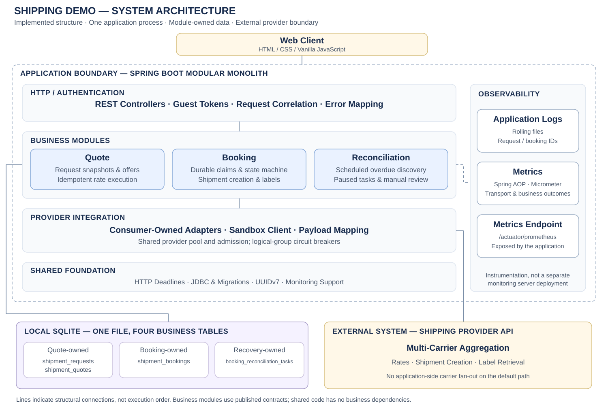

> **AI-assisted project:** AI tools supported implementation, review and documentation.

# Multi-Carrier Shipping — Designing for Failure

An independent shipping demo for Canadian domestic shipments: enter a parcel and route, compare carrier offers, select a quote, create a shipment, and retrieve its printable PDF label.

The project demonstrates three engineering choices:

- **Bound slow reads:** deadlines, circuit breakers and operation-specific bulkheads protect resources when an external service is slow.
- **Handle uncertain writes:** durable idempotency claims and a booking state machine prevent blind resubmission after a lost response.
- **Keep modules separable:** business modules own their data and communicate through published contracts and consumer-owned ports.

**Java 17 · Spring Boot 3.2 · Spring JDBC · SQLite · Resilience4j · Micrometer · HTML / CSS / Vanilla JavaScript**

**I10:** [Stateless quotes and provider-quote booking deduplication](docs/iterations/iteration-10-stateless-quotes.md), with read-only recovery and separate explicit known-unsent retry. A fresh two-business-table database baseline is used; historical-data migration is out of scope. Deployment and real-provider verification are separate from local implementation.

## 1. System Overview

The application runs as a **single-process modular monolith with one SQLite database**. The default quote path makes one call to an external multi-carrier aggregator; it does not persist quotes/requests or fan out to individual carriers on this path. Account authentication establishes the booking owner scope.

[](docs/design/demo-architecture.svg)

The diagram is the historical pre-I10 structure. The current [backend diagram](docs/design/backend-design.md#target-ownership-and-flow) removes quote persistence and booking-to-quote resolution. See [module boundaries](docs/design/module-boundaries.md) for current ownership.

## 2. Key Design Decisions

### Rate comparison: bound latency and resource use

**Failure scenario:** a slow rate provider occupies servlet threads and outbound connections, delaying other operations. For illustration, **4 requests/s × 16 seconds average duration = 64 in-flight requests**, matching the configured Tomcat worker limit before allowing headroom. This is an unguarded capacity estimate, not a measured threshold.

**Decision:** bound outbound work through one shared component. Each provider/carrier owns its connection pool and zero-wait total admission limit; the sandbox default is **8 concurrent calls across rates, creation and labels**. Logical groups have independent circuits and optional smaller concurrency limits. The core workflow currently uses one default group: rate traffic can consume booking capacity, and a shared circuit can stop all three operations. Add a group for independently failing or lower-priority work; groups still share connections. Local overload returns `503 PROVIDER_CAPACITY_EXCEEDED`.

**Implementation:** monotonic deadlines cover response headers and body consumption. Each valid rate query invokes the provider without business-table writes, a random key or a persisted execution lifecycle. The default breaker uses a 10-call window, a five-call minimum, a 50% failure threshold and a ten-second open interval. `shipping.outbound` inherits defaults through optional templates and dependency overrides; operation-level latency/outcome metrics guide tuning. Adaptive admission is reserved as an extension.

`SingleProviderRateEngine` implements the default aggregator path. The optional `HighFanOutAggregationEngine` supports direct carrier adapters with asynchronous aggregation, per-carrier bounded executors (`SynchronousQueue`), a global deadline and cooperative cancellation. It is retained as an alternative implementation behind `RateComparisonPort`.

### Shipment creation: distinguish rejection from an unknown outcome

**Failure scenario:** the provider creates and charges for a shipment, but its response is lost. Retrying creation may produce a second shipment and charge.

**Decision:** commit a durable booking claim before dispatch, perform external I/O outside database transactions, then persist the result with a version-fenced update. This avoids holding scarce database connections during a slow provider call.

**Implementation:** `UNIQUE(user_id, provider_id, provider_quote_id)` arbitrates initial submissions; only the committed insert winner dispatches. Different quotes may independently create shipments. Submitted input/display snapshots are not ownership proof or provider-confirmed prices. Ordinary create returns an existing booking without resending. GET status/quote-identity lookup are read-only. Only a separate explicit RETRYABLE retry can win a version-fenced claim and send using original saved facts. Provider quote uniqueness scope/reuse is an external-contract release gate; current configuration has one account per provider.

**Recovery tradeoff:** the current provider has no documented authoritative reference lookup and its creation idempotency is unverified. Overdue uncertain bookings therefore become `MANUAL_REVIEW`, with a deduplicated paused recovery task, instead of automatic creation retries. Normal successful bookings create no recovery task. This protects against duplicate application submissions while retaining claims; it does not guarantee external success or end-to-end exactly-once processing.

Label retrieval is a separate read operation against an existing confirmed shipment; it never recreates the shipment.

### Observability: connect failures to business outcomes

**Failure scenario:** a transport timeout alone does not explain whether a rate request can retry or a booking requires manual review.

**Decision and implementation:** request correlation IDs connect API logs to provider calls and durable booking IDs. Explicit error codes distinguish conflicts, provider timeouts and capacity failures. `shared/infrastructure/transport` records outbound transport latency and admission outcomes; application services record business and recovery outcomes through `SafeMetrics` without embedding Micrometer calls in domain logic. Provider configuration redacts credentials, and application event logs avoid shipment contact details.

## 3. Module Boundaries and Evolution

| Module | Responsibility and owned data | Published boundary |
| --- | --- | --- |
| `auth` | Account identity and token validation | HTTP authentication boundary |
| `shipping` | Rate queries, booking claims, state transitions and labels: `shipment_bookings` | `ShipmentRecovery` contract for reconciliation; provider capability ports |
| `reconciliation` | Scheduled discovery and manual-review tasks: `booking_reconciliation_tasks` | Consumes the shipping recovery contract only |
| `provider` | Provider protocol and independent API slices; no business tables | Implements consumer-owned provider adapters |

Business modules use peer modules' published `contract` packages rather than their internal domain, application or infrastructure classes. `ModuleBoundariesTest` checks these dependency rules. Provider adapters implement consumer-owned ports; shared HTTP guards, persistence helpers and monitoring avoid duplicate infrastructure implementations.

There are no cross-module database joins or foreign keys. This reduces coupling for future service extraction, but independent services still need remote contracts, failure handling and operational support. Horizontal scaling would require a suitable shared database deployment and coordinated provider quotas. Future user-based sharding must route requests before uniqueness checks; UUIDv7 improves index locality but does not provide shard routing. **MySQL/PostgreSQL and multi-node deployment have not been validated in this version.**

## 4. Validation and Known Limitations

| Area | Evidence |
| --- | --- |
| Backend/browser correctness | Current I10 evidence belongs in its delivery summary; earlier test totals are not acceptance of the new contract |
| Database scale | At commit `78c729e`: **3M requests, 15M quotes, 1.5M bookings and 150K recovery tasks**, using **9.67 GiB** |
| Indexed reads | At that scale, warmed P95 was **0.31 ms** for booking-key lookup and **0.60 ms** for quote-ID lookup |
| HTTP throughput | About **155 rate requests/s** and up to **61.4 confirmed rate-to-booking workflows/s** with a local provider stub |
| Historical fault handling | Old key-based concurrency, payload conflicts, failed-rate retries and lost creation responses were checked before I10 |

Performance tests used a **16 GiB RAM / 10 logical CPU Mac**. HTTP tests used a separate small database, a **20 ms local provider stub**, **4 rate / 2 create slots**, and **1–16 concurrent clients**, with three ten-second repetitions per scenario and level. Repository timings are not HTTP timings, and these short local tests do not establish production capacity.

**Load-test follow-up:** the historical run exposed local admission rejection being treated as an unknown external outcome. Proven-unsent attempts now remain RETRYABLE, with a separate explicit version-fenced sending endpoint. I10 removes quote persistence and changes booking identity, so historical throughput/database figures are not measurements of current code. HTTP `202 Accepted` remains pending, not confirmed creation.

Current automated tests use local stubs. Earlier live rate, booking and PDF checks are historical observations documented in the acceptance report.

[Load-test results & charts](docs/performance/load-test-results.md#visual-summary) · [Acceptance report](docs/summaries/acceptance-test-report.md)

## 5. Run and Verify

**Requirements:** JDK 17. The static frontend needs no build step. Optional browser tests require Node.js 20+.

```sh
# Backend tests; no provider credentials required
./mvnw test

# Optional browser setup and acceptance
npm ci
npm run browser:install
./mvnw test -Pbrowser-tests

# Copy the configuration template, then fill in local provider settings
cp .env.example .env
./scripts/start-workflow.sh
```

**I10 upgrade:** an old database may fail with `Applied migration checksum changed: V001__shipping_schema.sql`. Stop the app and run `./scripts/start-workflow.sh --reset-database` to **delete existing bookings and rebuild** the configured database plus WAL/SHM files. For deletion without startup, use `--reset-database-only`. Normal startup never silently resets data. To preserve the old file instead, run `SHIPPING_DATABASE_PATH=./data/stateless.db ./scripts/start-workflow.sh`; this explicit path overrides `.env`. See [upgrade/startup guidance](docs/runbooks/manual-acceptance.md#i10-upgrade-an-old-database-must-be-explicitly-rebuilt).

Packaged-launcher acceptance (isolated database and loopback provider, no real carrier writes): `python3 tests/system/packaged-startup.py`. It builds/starts the actual JAR, verifies database override/reset and linked CSS resources, then exercises login, quotes, booking replay, status and PDF label. Browser acceptance additionally asserts computed application styles and rejects an injected stylesheet 404. Evidence is written to `target/packaged-startup/`.

The launcher reads the ignored local `.env` file or exported environment variables. Configure `SHIPPING_PROVIDER_BASE_URL`, `SHIPPING_PROVIDER_USERNAME` and `SHIPPING_PROVIDER_PASSWORD`; keep credentials out of Git. Real provider shipment creation may be chargeable.

Open **http://127.0.0.1:8080/**. Application logs default to `logs/shipping.log`; metrics are available at **http://127.0.0.1:9091/actuator/prometheus**. Test reports are generated in `target/surefire-reports/`; archive backend results before the browser run if retaining both, because the browser run replaces the same test-class report.

## 6. Explore the Design and Code

| Topic | Entry point |
| --- | --- |
| Rate orchestration | [QuoteService](src/main/java/com/enterprise/shipping/shipping/application/QuoteService.java) |
| Booking orchestration | [BookingService](src/main/java/com/enterprise/shipping/shipping/application/BookingService.java) |
| Booking invariants | [ShipmentBooking](src/main/java/com/enterprise/shipping/shipping/model/ShipmentBooking.java) |
| Recovery discovery | [RecoveryJob](src/main/java/com/enterprise/shipping/reconciliation/RecoveryJob.java) |
| Shared outbound resilience | [OutboundProtection](src/main/java/com/enterprise/shipping/shared/infrastructure/transport/OutboundProtection.java) |

[Data dictionary](docs/design/data-dictionary.md) · [Module architecture](docs/design/module-boundaries.md) · [Backend design](docs/design/backend-design.md) · [Frontend API contract](docs/design/application-api.md) · [Delivery plan](docs/iterations/delivery-plan.md)
