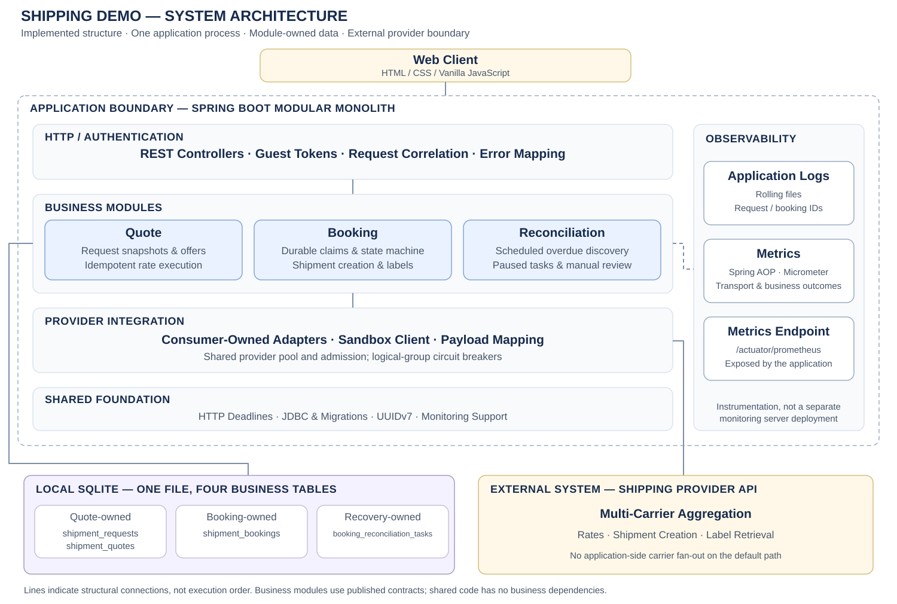

> **AI-assisted project:** AI tools supported implementation, review and documentation.

# Multi-Carrier Shipping — Designing for Failure

An independent shipping demo for Canadian domestic shipments: enter a parcel and route, compare carrier offers, select a quote, create a shipment, and retrieve its printable PDF label.

The project demonstrates three engineering choices:

- **Bound slow reads:** deadlines, circuit breakers and operation-specific bulkheads protect resources when an external service is slow.
- **Handle uncertain writes:** durable idempotency claims and a booking state machine prevent blind resubmission after a lost response.
- **Keep modules separable:** business modules own their data and communicate through published contracts and consumer-owned ports.

**Java 17 · Spring Boot 3.2 · Spring JDBC · SQLite · Resilience4j · Micrometer · HTML / CSS / Vanilla JavaScript**

## 1. System Overview

The application runs as a **single-process modular monolith with one SQLite database**. The default quote path makes one call to an external multi-carrier aggregator; the application does not fan out to individual carriers on this path. Guest authentication establishes a user scope for requests and bookings.

[](docs/design/demo-architecture.svg)

The diagram shows the implemented system structure, with shared infrastructure and observability alongside the business layers. Lines indicate structural connections, not execution order. Each business module owns its tables within the same SQLite database. See [module boundaries](docs/design/module-boundaries.md) for code dependency details.

## 2. Key Design Decisions

### Rate comparison: bound latency and resource use

**Failure scenario:** a slow rate provider occupies servlet threads and outbound connections, delaying other operations. For illustration, **4 requests/s × 16 seconds average duration = 64 in-flight requests**, matching the configured Tomcat worker limit before allowing headroom. This is an unguarded capacity estimate, not a measured threshold.

**Decision:** bound outbound work and isolate operations. The provider adapter owns separate connection pools, zero-wait bulkheads and circuit breakers for rates, creation and labels. Default concurrency limits are **8 / 4 / 8** respectively. Rate overload fails admission with `503 PROVIDER_CAPACITY_EXCEEDED`; CPU, servlet threads and database connections remain shared.

**Implementation:** monotonic deadlines cover response headers and body consumption. A persisted request snapshot and content fingerprint coalesce same-key in-flight submissions; version-fenced updates allow failed or expired rate requests to retry without a second concurrent execution. The current provider breaker uses a 10-call window, a five-call minimum, a 50% failure threshold and a ten-second open interval.

`SingleProviderRateEngine` implements the default aggregator path. The optional `HighFanOutAggregationEngine` supports direct carrier adapters with asynchronous aggregation, per-carrier bounded executors (`SynchronousQueue`), a global deadline and cooperative cancellation. It is retained as an alternative implementation behind `RateComparisonPort`.

### Shipment creation: distinguish rejection from an unknown outcome

**Failure scenario:** the provider creates and charges for a shipment, but its response is lost. Retrying creation may produce a second shipment and charge.

**Decision:** commit a durable booking claim before dispatch, perform external I/O outside database transactions, then persist the result with a version-fenced update. This avoids holding scarce database connections during a slow provider call.

**Implementation:** `UNIQUE(user_id, idempotency_key)` arbitrates same-key submissions; `UNIQUE(user_id, request_id)` also prevents different keys from booking the same request twice. The `ShipmentBooking` aggregate enforces transitions between pending, confirmed, rejected and uncertain outcomes. Confirmed or uncertain replays return the existing state without another creation request. A proven local admission rejection is stored as `RETRYABLE`; an explicit same-key retry must win a version-fenced claim before dispatching the original booking.

**Recovery tradeoff:** the current provider has no documented authoritative reference lookup and its creation idempotency is unverified. Overdue uncertain bookings therefore become `MANUAL_REVIEW`, with a deduplicated paused recovery task, instead of automatic creation retries. Normal successful bookings create no recovery task. This protects against duplicate application submissions while retaining claims; it does not guarantee external success or end-to-end exactly-once processing.

Label retrieval is a separate read operation against an existing confirmed shipment; it never recreates the shipment.

### Observability: connect failures to business outcomes

**Failure scenario:** a transport timeout alone does not explain whether a rate request can retry or a booking requires manual review.

**Decision and implementation:** request correlation IDs connect API logs to persisted request and booking IDs. Explicit error codes distinguish conflicts, provider timeouts and capacity failures. Spring AOP measures outbound transport latency; observer ports collect business outcomes and overdue-booking metrics without embedding Micrometer calls in domain logic. Provider configuration redacts credentials, and application event logs avoid shipment contact details.

## 3. Module Boundaries and Evolution

| Module | Responsibility and owned data | Published boundary |
| --- | --- | --- |
| `auth` | Guest identity and token validation | HTTP authentication boundary |
| `quote` | Request snapshots and offers: `shipment_requests`, `shipment_quotes` | `QuoteSelectionPort` for booking; rate-provider ports for external I/O |
| `booking` | Booking claims, state transitions and labels: `shipment_bookings` | `ShipmentRecoveryPort` for discovery and escalation |
| `reconciliation` | Scheduled discovery and manual-review tasks: `booking_reconciliation_tasks` | Uses booking contracts and a provider-capability port |

Business modules use peer modules' published `contract` packages rather than their internal domain, application or infrastructure classes. `ModuleBoundariesTest` checks these dependency rules. Provider adapters implement consumer-owned ports; shared HTTP guards, persistence helpers and monitoring avoid duplicate infrastructure implementations.

There are no cross-module database joins or foreign keys. This reduces coupling for future service extraction, but independent services still need remote contracts, failure handling and operational support. Horizontal scaling would require a suitable shared database deployment and coordinated provider quotas. Future user-based sharding must route requests before uniqueness checks; UUIDv7 improves index locality but does not provide shard routing. **MySQL/PostgreSQL and multi-node deployment have not been validated in this version.**

## 4. Validation and Known Limitations

| Area | Evidence |
| --- | --- |
| Backend correctness | **115 tests passed**, covering API behavior, SQLite persistence, concurrency and architecture boundaries |
| Browser workflow | Separate Playwright Chromium journey passed against local provider stubs |
| Database scale | At commit `78c729e`: **3M requests, 15M quotes, 1.5M bookings and 150K recovery tasks**, using **9.67 GiB** |
| Indexed reads | At that scale, warmed P95 was **0.31 ms** for booking-key lookup and **0.60 ms** for quote-ID lookup |
| HTTP throughput | About **155 rate requests/s** and up to **61.4 confirmed rate-to-booking workflows/s** with a local provider stub |
| Fault handling | Concurrent idempotency, payload conflicts, failed-rate retries and lost creation responses were checked |

Performance tests used a **16 GiB RAM / 10 logical CPU Mac**. HTTP tests used a separate small database, a **20 ms local provider stub**, **4 rate / 2 create slots**, and **1–16 concurrent clients**, with three ten-second repetitions per scenario and level. Repository timings are not HTTP timings, and these short local tests do not establish production capacity.

**Load-test follow-up:** the recorded run produced 3,173 `PENDING_INQUIRY` bookings, exposing local admission rejection being treated as an unknown external outcome. The backend now persists proven-unsent attempts as `RETRYABLE` and allows a same-key, version-fenced retry. Targeted regression tests cover this fix; the full load benchmark has not been rerun. HTTP `202 Accepted` remains pending, not confirmed creation.

Current automated tests use local stubs. Earlier live rate, booking and PDF checks are historical observations documented in the acceptance report.

[Load-test results](docs/performance/load-test-results.md) · [Acceptance report](docs/summaries/acceptance-test-report.md)

## 5. Run and Verify

**Requirements:** JDK 17. The static frontend needs no build step. Optional browser tests require Node.js 20+.

```sh
# Backend tests; no provider credentials required
./mvnw test

# Optional browser setup and acceptance
npm ci
npm run browser:install
./mvnw test -Pbrowser-tests

# Copy the configuration template, then fill in local provider settings
cp .env.example .env
./scripts/start-workflow.sh
```

New databases are initialized directly from `db/shipping/V001__shipping_schema.sql`, the consolidated first-release schema. When switching from an earlier development build, stop the application and remove its disposable local database file and any matching `-wal` / `-shm` files, then run the same launcher. No path change or historical migration is required. Subsequent starts retain data; files are never reset automatically.

The launcher reads the ignored local `.env` file or exported environment variables. Configure `SHIPPING_PROVIDER_BASE_URL`, `SHIPPING_PROVIDER_USERNAME` and `SHIPPING_PROVIDER_PASSWORD`; keep credentials out of Git. Real provider shipment creation may be chargeable.

Open **http://127.0.0.1:8080/**. Application logs default to `logs/shipping.log`; metrics are available at **http://127.0.0.1:9091/actuator/prometheus**. Test reports are generated in `target/surefire-reports/`; archive backend results before the browser run if retaining both, because the browser run replaces the same test-class report.

## 6. Explore the Design and Code

| Topic | Entry point |
| --- | --- |
| Rate orchestration | [QuoteApplicationService](src/main/java/com/enterprise/shipping/quote/application/QuoteApplicationService.java) |
| Booking orchestration | [ShipmentApplicationService](src/main/java/com/enterprise/shipping/booking/application/ShipmentApplicationService.java) |
| Booking invariants | [ShipmentBooking](src/main/java/com/enterprise/shipping/booking/domain/ShipmentBooking.java) |
| Recovery discovery | [PendingShipmentDiscovery](src/main/java/com/enterprise/shipping/reconciliation/application/PendingShipmentDiscovery.java) |
| Shared outbound resilience | [OutboundOperation](src/main/java/com/enterprise/shipping/shared/infrastructure/http/OutboundOperation.java) |

[Module architecture](docs/design/module-boundaries.md) · [Backend design](docs/design/backend-design.md) · [Frontend API contract](docs/design/application-api.md) · [Delivery plan](docs/iterations/delivery-plan.md)
