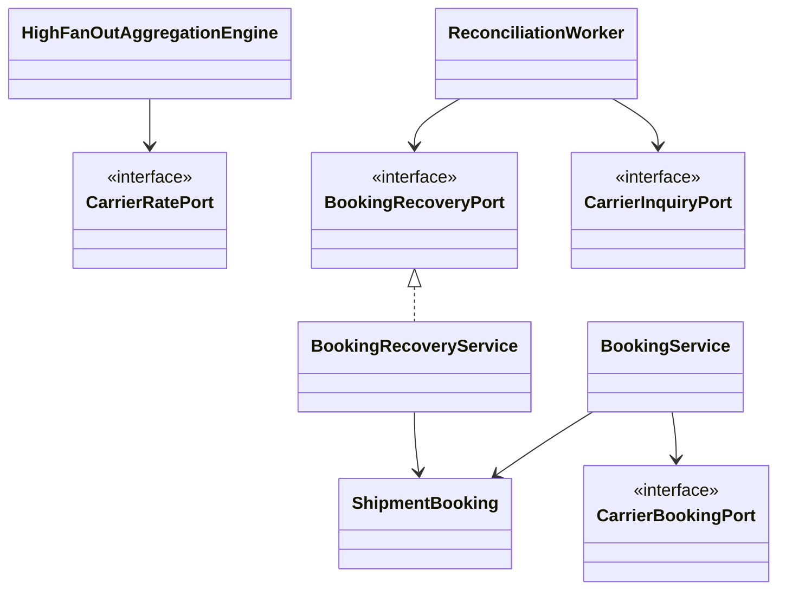

> **AI-assisted project:** AI tools helped with documentation, code review, and implementation. Design decisions, tradeoffs, and validation results are documented for technical discussion.

# Multi-Carrier Shipping — Designing for Failure

An independent demo of resilient distributed application patterns, using simulated carrier integrations and synthetic scenarios. Two workflows make the engineering tradeoffs concrete: **compare shipping rates** and **create a shipment**.

**Java 17 · Spring Boot · Spring JDBC · SQLite · Resilience4j · Micrometer · Prometheus**

## 1. Rate Comparison: Bound Latency and Isolate Failures

A quote request fans out to independent carrier APIs. One carrier might respond in **200 ms**, while another takes **4,000 ms** or never responds. At an illustrative **100 requests/second × 12 carriers**, outbound demand reaches **1,200 calls/second** before retries.

- **Asynchronous fan-out / scatter-gather:** bounded per-carrier `ThreadPoolExecutor` workers and `ExecutorCompletionService` run calls concurrently and collect completed results. The implementation uses Java 17 platform threads and Spring `WebClient`.
- **Global timeout budget:** monotonic request and per-carrier deadlines, transport timeouts, and cooperative cancellation bound waiting. Available quotes survive a slow or failed dependency; responses distinguish complete, partial, and failed comparisons.
- **Circuit breakers:** independent Resilience4j breakers track carrier failures/slow calls and admit limited recovery probes. Local capacity rejection is excluded from breaker failure accounting.
- **Bulkhead isolation:** per-carrier semaphore limits, bounded workers with no task backlog, and dedicated Reactor Netty connection pools prevent one carrier from consuming another carrier's allocated capacity.

The request workflow keeps no durable quote state. Replicas can serve requests independently; outbound limits and circuit-breaker state are currently local to each instance. Fleet-wide carrier quotas require additional coordination.

## 2. Shipment Creation: Preserve Correctness Across Uncertain Outcomes

A carrier can accept a shipment while its response is lost. A timeout therefore means **unknown outcome**, not failed creation. Retrying the side effect blindly could create a duplicate shipment or charge.

- **Durable idempotency:** a unique owner/key constraint arbitrates the initial claim. A normalized request fingerprint rejects changed intent under the same key; matching retries return persisted business state.
- **Short atomic database writes:** persist the claim before the carrier call. No database transaction spans network I/O; conditional version checks guard subsequent business transitions.
- **Explicit state machine:** the `ShipmentBooking` aggregate controls `PENDING`, `CONFIRMED`, `FAILED`, `PENDING_INQUIRY`, and `MANUAL_REVIEW`, including receipt validation and terminal-state rules.
- **Inquiry-only reconciliation:** an independent module discovers uncertain or abandoned bookings, persists carrier/account/reference identity, and performs lookup without resubmitting. Its own table owns leases, retry backoff, attempts, and durable observations. Normal successful bookings create no recovery task.
- **Failure-safe result delivery:** saved observations survive restart or a lost acknowledgement. Repeated delivery is handled idempotently by the booking-owned recovery interface; stale task writes are fenced by lease token and version.

These mechanisms provide durable local coordination and eventual outcome reconciliation. They do not make a database and an external carrier one atomic distributed transaction; remote guarantees depend on the carrier's idempotency and lookup contract. The demo creates no real shipment or charge.

## 3. Module Boundaries and Horizontal Scaling

| Boundary | Implemented | Extension point |
| --- | --- | --- |
| Quote requests | Stateless request orchestration; per-instance resource limits | Add replicas while budgeting aggregate carrier capacity |
| Booking data | UUIDv7 identities, owner-scoped uniqueness, immutable booking locator, version-guarded writes behind `BookingStore` | Add a production database and shard routing; route each owner's idempotency scope consistently |
| Recovery | Separate task ownership; neutral `BookingRecoveryPort`; no cross-module table joins or writes | Extract a worker process and replace in-process calls with an authenticated transport |
| Carrier integration | Separate rate, submission, and inquiry ports | Add carrier adapters without changing core workflows |

**Current deployment:** one modular application with local SQLite storage. Shard routing, cross-shard uniqueness, multi-host deployment, and remote recovery transport are design extensions, not implemented features. A UUID alone does not route requests or preserve owner/key uniqueness across shards.

[Generic platform architecture](docs/design/architecture.md): the wider service layout below provides design context; the implemented scope is rate comparison, booking, reconciliation, and local observability.

[](docs/design/platform-architecture.svg)



## 4. Observability: Explain the Failure, Preserve the Workflow

- **Operational logs:** quote request IDs and booking/task IDs link workflow events with carrier outcomes, state transitions, retries, and safe failure types. Parcel payloads, credentials, and raw idempotency keys are excluded from application logs.
- **Explicit errors:** HTTP mapping distinguishes invalid input, idempotency conflicts, unavailable storage, capacity rejection, dependency failure, and timeouts. Per-carrier outcomes explain missing quotes; an uncertain booking is returned as pending rather than a definitive rejection.
- **Decoupled metrics:** Spring AOP instruments carrier transport; observer ports keep Micrometer out of application decisions. Prometheus exposes latency histograms, capacity, outcomes, and reconciliation events with bounded labels. Instrumentation failures do not change business results.

Centralized logging, alert rules, and end-to-end distributed tracing are architecture extensions; the local demo exposes logs and metrics.

## 5. Run and Verify

**Requirements:** JDK 17. The `demo` profile supplies simulated carriers, synthetic prices, configurable failure modes, and a fixed local owner.

```sh
./mvnw test
./mvnw spring-boot:run -Dspring-boot.run.profiles=demo
```

```sh
curl -sS http://127.0.0.1:8080/api/shipping/quotes \
  -H 'Content-Type: application/json' \
  -d '{"originPostalCode":"L6K 3V3","destinationPostalCode":"M5V 2T6","weight":1,"weightUnit":"KG","dimensionUnit":"CM","length":10,"width":10,"height":10}'
```

| Scenario | Expected result |
| --- | --- |
| Both carriers available | `200 / COMPLETE`; quotes sorted by price |
| One carrier times out | `200 / PARTIAL`; healthy-carrier results retained |
| Both carriers fail | `502 / FAILED`; explicit dependency outcomes |
| Repeated booking with identical owner/key/intent | Same booking identity; no additional submission |
| Carrier accepts but submission response is lost | `202 / PENDING_INQUIRY`, followed by inquiry-based recovery |

**Latest code validation:** clean package build with **90 passing tests**, including concurrent claims, timeout/restart recovery, stale lease fencing, lost acknowledgements, UUIDv7 generation, and JDBC query plans. These are correctness checks, not production throughput benchmarks.

Metrics: `http://127.0.0.1:9091/actuator/prometheus`.

[Rate scenarios](docs/runbooks/demo.md) · [Booking and restart recovery](docs/runbooks/booking-demo.md) · [Code entry points](docs/design/implementation-map.md) · [Recovery design](docs/design/reconciliation.md) · [Discussion guide](docs/interview/walkthrough.md)

Engineering references: [timeouts and backoff](https://aws.amazon.com/builders-library/timeouts-retries-and-backoff-with-jitter/) · [idempotent APIs](https://aws.amazon.com/builders-library/making-retries-safe-with-idempotent-APIs/) · [Resilience4j](https://resilience4j.readme.io/docs/circuitbreaker).
