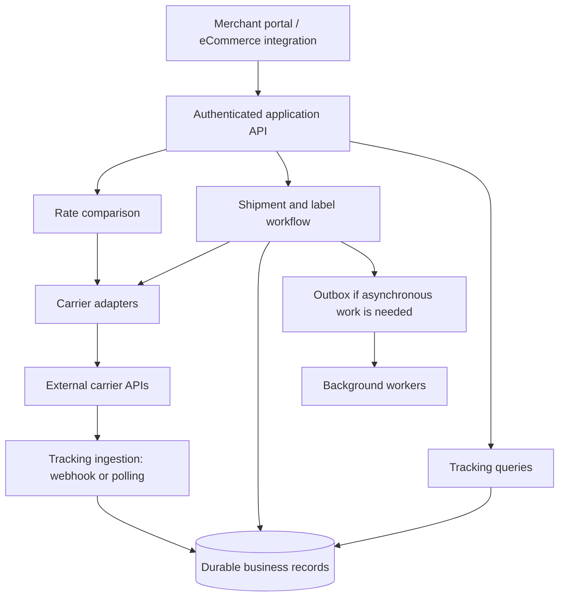

# Proposed platform architecture

This is an interview design inferred from public capabilities. ShipTime's actual architecture is unknown.

## Logical composition

Logical boxes are module boundaries, not a requirement to deploy separate services. Start with a modular application unless measured load, team ownership, or deployment needs justify extraction. Preserve explicit interfaces so carrier integration details do not spread into the domain.

## Components and decisions

| Component | Responsibility | Key boundary |
| --- | --- | --- |
| Account and access | Resolve authenticated tenant and permitted carrier accounts | Never trust a request-supplied tenant identifier alone |
| Rate comparison | Validate, dispatch, normalize, rank, report coverage | No purchase side effects |
| Carrier adapters | Translate protocols, units, capabilities, and error types | Domain model independent of carrier payloads |
| Shipment and labels | Book selected service; reconcile uncertain results | Durable idempotency and booking state |
| Tracking ingestion | Retain events and derive current state | Duplicate and ordering tolerance |
| Billing and reconciliation | Record charges and adjustments | Quote estimates distinguished from final charges |
| Operations | Trace requests, inspect failures, replay permitted work | Redaction and access controls |

## Critical tradeoffs

- Parallel quote collection reduces sequential waiting but consumes outbound capacity. Bound per-carrier concurrency and queued work; protect the process under load.
- An overall deadline bounds user waiting. Each call also needs transport timeouts; completing a future exceptionally does not prove its underlying HTTP call stopped.
- Return available valid quotes with explicit carrier outcomes. Empty success, timeout, unsupported shipment, and dependency failure have different meanings.
- Cache only with complete shipment, account/rate context, currency, and option identity. Decide whether freshness and pricing rules justify caching before adding it.
- A SQL store is a reasonable proposed choice for durable booking and financial records. A broker, Redis, Kubernetes, and microservices require an actual need; they are not established ShipTime technologies.

## Booking after quoting

Validate quote ownership and freshness before purchase. Persist an idempotency record and explicit booking state. A booking timeout may mean the carrier accepted the shipment; reconcile using carrier-supported references or lookup before retrying. Local database transactions cannot atomically commit a remote carrier operation. An outbox helps reliable local event publication but does not by itself guarantee exactly-once carrier booking.

## Operational evidence

Measure request latency, per-carrier latency/outcomes, executor saturation, rejected work, and outbound timeouts. Use request IDs for investigation. Avoid putting addresses, credentials, or unbounded identifiers into metrics labels. No production throughput or SLA claim is made by this document.
