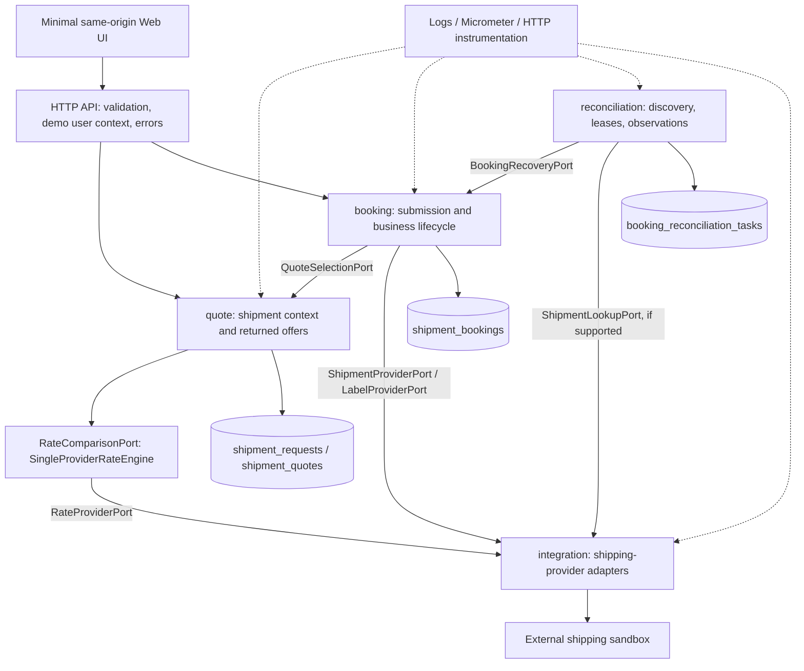
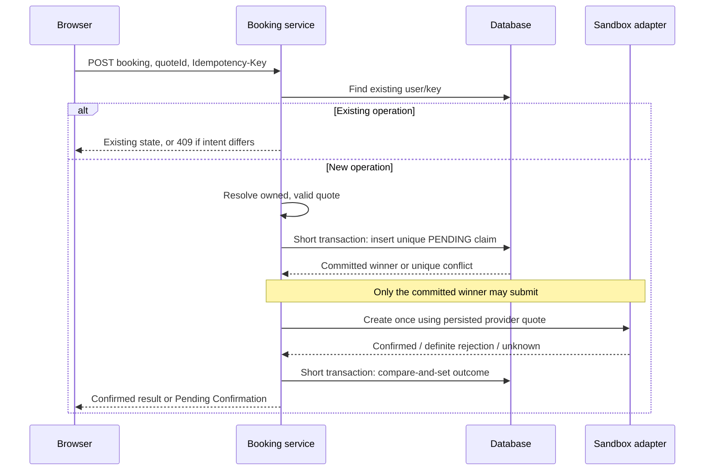
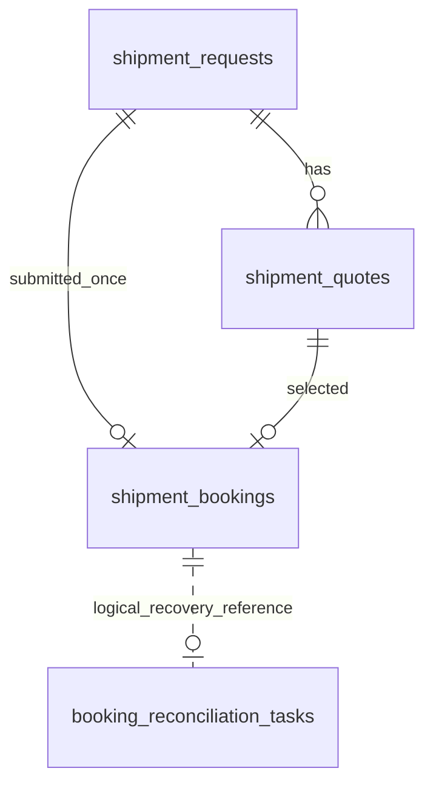

# Shipping workflow — backend technical design

**Version:** 0.6  
**Status:** Demo design baseline through I4; implementation evidence is recorded in iteration summaries  
**Date:** 2026-10-23  
**Inputs:** [PRD v1.3](../prd/shipping-workflow.md), [requirements review](../prd/requirements-review.md), [delivery plan](../iterations/delivery-plan.md).

## 1. Scope and principal decisions

Build a Canadian domestic, single-package shipping application: enter details → obtain rates → select an exact quote → confirm creation → retrieve confirmation and label. Describe the target as a new system; existing code is an execution asset, not an architectural constraint. This document specifies intended behavior; it does not claim that implementation is complete.

| Concern | Proposed decision |
| --- | --- |
| Deployment | Java 17 / Spring Boot modular monolith; same-origin HTML + Bootstrap 5 + Vanilla JavaScript UI; SQLite for local demonstration |
| Identity | Fixed configurable demo user without login; production identity comes from the authenticated principal; all four tables carry `user_id` |
| External integration | One shipping-provider sandbox adapter obtains rates across carriers and creates shipments; the application does not fan out directly to individual carriers |
| Shipment intent | Persist an immutable address/package/date snapshot and the exact returned quotes; creation accepts a quote ID rather than client-supplied prices or carrier details |
| Write safety | Commit one booking claim before external submission; scope idempotency to a backend-resolved user ID and enforce one booking per shipment request |
| Uncertain outcome | Persist Pending Confirmation; never automatically resubmit creation; recover only using a verified provider capability |
| Label | Independent availability state on an already-confirmed booking; retrieve without creating another shipment |
| Data boundaries | Four application tables: shipment requests, quotes, bookings and recovery tasks; no e-commerce order domain in this scope |
| Observability | Structured logs, stable application error codes, Micrometer observers and transport instrumentation |

Non-goals: direct carrier integrations, distributed service deployment, payments, order management, history, full tracking, cancellation, a queue cluster, and a separate frontend design. These can be later capabilities rather than dependencies of this journey.

### Core engineering challenges and design responses

| Challenge | Mechanism | Evidence required |
| --- | --- | --- |
| **Provider tail latency and resource exhaustion** | Even one provider can saturate the system: total deadlines, connection/acquisition/read timeouts, bounded concurrency and admission, circuit breakers, separate rate/create capacity budgets (Section 6) | Slow/outage scenarios show bounded threads/connections, fast admission rejection, bounded P95/P99 latency and recovery |
| **Concurrent local write idempotency** | Durable claim before dispatch, unique user/key and user/request constraints, intent fingerprint, state machine and compare-and-set updates (Section 3.2) | Same-key and different-key duplicates race safely; changed intent conflicts; restart preserves operation identity |
| **Ambiguous external creation and charging** | Persist a stable client reference; use externally guaranteed idempotency only when verified; no blind create retries; authoritative inquiry and durable recovery evidence (Section 3.3) | Lost response, accepted-before-crash, failed local save and late evidence do not trigger another creation |
| **Operational visibility and performance** | Business observers plus transport AOP, structured correlation, latency histograms, saturation and uncertainty-age metrics, indexed keyset discovery and bounded batches (Sections 4, 6 and 7) | Failure signals identify the affected operation; load/query-plan checks establish actual behavior rather than assumed throughput |
| **Maintainability and independent evolution** | Cohesive domains, published module contracts, isolated provider adapters, independent recovery storage and explicit typed outcomes (Sections 2 and 7) | Domain, contract and persistence tests cover invariants; recovery cannot call create or mutate booking tables directly |

Local uniqueness cannot guarantee external exactly-once charging. **Reconciliation establishes what happened; financial compensation reverses an established effect.** Any future void/refund needs a verified provider contract, its own durable identity, idempotency, state transitions and ambiguous-outcome recovery. Automatic financial compensation is not promised by this design and remains conditional on the external API specification.

## 2. Architecture and module ownership



One local database file can hold all four tables; each module owns its repositories and transactions. Reconciliation never reads or updates booking tables directly. There are no distributed transactions or mandatory task writes on successful submission.

| Module | Responsibility and domain behavior | Dependency rules |
| --- | --- | --- |
| `quote` | `ShipmentRequest` validates Canadian shipping intent and freezes the snapshot; `QuoteSet` controls readiness and expiry; `ShippingQuote` identifies a service and monetary offer | Owns input/quote storage and exposes an immutable selection contract to booking |
| `booking` | `ShipmentBooking` enforces transitions, immutable submission identity, confirmed receipts and independent label availability | Uses quote's public selection contract and its own outbound provider ports; owns booking storage and recovery application |
| `reconciliation` | `ReconciliationTask` controls scheduling, leases, retry limits and durable observation delivery | Uses booking's public recovery contract and a read-only provider lookup port; has no create-shipment capability |
| `integration` | Maps application commands to the configured sandbox and translates responses/errors into application types | Implements outbound ports; does not decide business state or access application tables |
| `shared` | Small value types such as address, parcel, money, IDs, clock and cross-cutting infrastructure | No workflows or module repositories; avoid a general-purpose shared service layer |

Within a business module use `api/`, `application/`, `domain/`, `port/` and `infrastructure/` where needed. Published in-process contracts live with the owning module, for example `quote/contract/QuoteSelectionPort` and `booking/contract/BookingRecoveryPort`. Consumers depend on those contracts, not repositories or aggregates. Spring configuration assembles implementations; no separate runtime business module is needed.

### Module contracts

These signatures describe semantics, not final Java syntax or provider payloads.

| Contract / owner | Operations | Guarantees |
| --- | --- | --- |
| `QuoteSelectionPort` / quote | `resolve(userId, quoteId, now) → SelectedQuote` | Returns owner-checked immutable intent, exact offer, provider selection context and validity; rejects unavailable/expired offers |
| `BookingRecoveryPort` / booking | `discover(cursor, limit) → RecoveryPage`; `apply(observation) → ApplyResult` | Discovers overdue unresolved attempts; validates identity and applies evidence with optimistic concurrency; duplicate delivery is harmless |
| `RateComparisonPort` / quote | `compare(intent, deadline) → RateResult` | Common orchestration contract implemented separately by single-provider and fan-out engines; application services do not select transport behavior |
| `RateProviderPort` / quote | `fetchRates(intent, deadline) → RateResult` | Bounded read; returns actual offers, optional provider expiry, and known completeness information |
| `ShipmentProviderPort` / booking | `create(submission) → ConfirmedReceipt / DefiniteRejection / UnknownOutcome` | Submission uses the persisted exact provider quote and account context; retain a local correlation reference without assuming it can be sent in quote-only mode; no hidden retry of creation |
| `ShipmentLookupPort` / reconciliation | `lookup(reference, deadline) → Found / NotFound / InProgress / Unsupported / Unavailable` | Read-only; Found must include enough verified identity and receipt evidence to confirm creation; NotFound never authorizes resubmission |
| `LabelProviderPort` / booking | `fetch(existingShipmentIdentity) → Available / Pending / Unavailable` | Acts on a confirmed existing shipment; cannot create a shipment |
| Module observer ports | `record(operation, outcome, duration)` | Low-cardinality metrics without domain dependencies on Micrometer; HTTP annotation/AOP records transport timing separately |

`SelectedQuote` contains user ID, request ID, quote ID, immutable intent, provider/account context alias, carrier/service codes, accepted total/currency and expiry policy. A `ConfirmedReceipt` requires a provider shipment ID; tracking and label may be absent. Recovery observations include user ID, booking ID, routing locator, persisted client reference, provider/account alias, evidence classification and receipt if known. Aliases are configuration identifiers, never credentials.

### Rate strategies and shipping-provider abstraction

```text
Quote application service → RateComparisonPort
                            ├── SingleProviderRateEngine → RateProviderPort → sandbox adapter
                            └── HighFanOutAggregationEngine → individual carrier adapters
```

Implement `SingleProviderRateEngine` separately; do not force the sandbox through the fan-out engine as a one-element carrier list. Configuration selects one engine. Both satisfy the common rate result contract; adapt the existing fan-out implementation to that contract while preserving its separate demo/test role. The product configuration uses the single-provider engine and does not activate direct-carrier fan-out alongside it.

The sandbox is a **shipping provider**, not a carrier: one integration can return offers from several carriers. Keep `providerId` (integration identity), `carrierId` (fulfilling carrier), provider quote identity and internal quote ID distinct. Capability-specific provider ports remain separate; do not require an adapter to implement unsupported lookup or cancellation. Shared HTTP construction, timeout policy, circuit-breaker/bulkhead components and instrumentation can be reused without sharing orchestration behavior or mutable capacity pools.

### Boundaries for later service extraction

Each module owns its domain, repositories, tables and transactions. Publish immutable DTOs and explicit result types through owner-defined contracts; no aggregate instances, JDBC objects, cross-module SQL joins or cross-module transactions cross those boundaries. Internal calls can later be replaced with RPC without changing domain responsibilities; RPC still needs explicit deadlines, transport-error handling and authenticated service identity.

Booking resolves an owned, valid selection before claiming. Once claimed, persist the minimum immutable submission facts in booking: request/quote identities, provider quote token, provider/account identity, carrier/service, accepted amount/currency and validity at admission. They form the booking-owned submission snapshot; booking must not call quote again to replay, submit the persisted quote-only request, or apply recovery. Full sender/recipient/parcel data remains quote-owned for this integration; if a future provider requires it during submission, explicitly extend the booking-owned snapshot rather than perform an unsafe post-claim remote read.

The identity context is backend-resolved `user_id`, not a user ID trusted from a browser. Routing, correlation and deadlines are explicit contract context. Discovery and evidence delivery remain service contracts; recovery never accesses booking tables. Retention of referenced quote data needs a coordinated policy rather than a cross-module cascading delete. The initial deployment is one process; service extraction and shard deployment remain future operational work.

## 3. End-to-end mechanisms

### 3.1 Rate retrieval and exact selection

1. Validate the full sender/recipient, parcel and shipping date. Preserve entered IN/LB values; use exact decimal conversion where the provider requires another unit. Default the date using configured business timezone; provider cutoff/calendar rules remain an integration gate.
2. Insert an immutable `shipment_requests` snapshot in `RATING`; commit before the provider call.
3. Use `SingleProviderRateEngine` through `RateComparisonPort` to call the sandbox once for its multi-carrier rate result with bounded concurrency and a total deadline. In a short transaction, insert returned offers and change the request to `READY`, `NO_RATES` or `RATE_FAILED`.
4. Return internal quote IDs, service details, actual amounts and known estimates. Missing transit estimates and charge components are null, never invented. A crashed `RATING` request becomes stale and cannot be booked; a new read request is safe.
5. Creation resolves the selected quote on the server. Editing any shipping input creates a new snapshot and invalidates the UI selection; it does not mutate the old snapshot. The UI also ignores late responses for an older form revision.

Use the documented **quote-only Create Shipment** mode to preserve quote-based billing; do not mix additional shipment/reference properties into this mode without a verified contract. The documented quote lifetime is approximately 15 minutes, so apply a conservative admission margin rather than treating it as an exact expiry timestamp. Store provider-issued expiry when available. Otherwise apply a configurable local maximum quote age, clearly treated as admission policy rather than a provider price guarantee. At creation admission, resolve validity with a submission safety margin. If the provider cannot honor the accepted quote/price or enforce an acceptable-price condition, validate its create-price semantics before enabling this path; do not promise protection against post-creation price changes from a local TTL alone. Refreshing produces a new selection and requires user confirmation.

### 3.2 Creation claim, idempotency and transaction boundaries



- Require `Idempotency-Key` on create. The browser generates it once per explicit submission and retains it across network retries. A key reused with another quote returns `409 IDEMPOTENCY_CONFLICT`. Hash normalized application intent and quote identity, not raw JSON formatting.
- Fast read is an optimization. Unique `(user_id, idempotency_key)` is the correctness boundary. Additionally, unique `(user_id, request_id)` prevents two keys or two quotes from booking the same immutable shipment request twice.
- On a `(user_id, request_id)` collision with another key, return `409 SHIPMENT_ALREADY_SUBMITTED` with the owned existing operation location. The same key and same intent replays its current state. An intentionally new shipment requires a new request/quote flow.
- The insertion transaction commits before any network call. Only its successful caller submits; conflict losers read the committed winner. No outer transaction encloses lookup, claim and HTTP. An isolated transaction is sufficient; `REQUIRES_NEW` is only needed if a caller actually has an outer transaction. Do not swallow a uniqueness violation inside a rollback-only transaction.
- Persist booking ID, selected quote identity and provider token, accepted service/amount, request hash, provider/account alias and local client reference before submission. Submission uses this booking-owned snapshot, without another quote-module lookup. The local reference remains stable for the attempt; sending it to the provider is conditional on verified compatibility with quote-only creation. Application retries, HTTP-client retries and proxy retries must not repeat creation.
- A definite business rejection changes `PENDING → REJECTED`. An authoritative success changes `PENDING → CONFIRMED`. Timeouts, potentially-after-commit provider server errors, connection ambiguity, malformed success responses or a success followed by a failed database save leave an unresolved operation: `PENDING_CONFIRMATION` or overdue `PENDING`.
- Claim-before-call intentionally sacrifices automatic retry if a process crashes before sending. With no provider idempotency/authoritative lookup, a crash before sending and a crash after acceptance cannot always be distinguished. This design prevents automatic duplicate submission; it does not claim end-to-end exactly-once execution or charging.
- Replaying an operation returns its latest business state, not byte-identical cached JSON. A database outage after submission must not be reported as a definite provider failure.

### 3.3 Recovery and restart

Booking states: `PENDING → CONFIRMED | REJECTED | PENDING_CONFIRMATION`; unresolved states can become `CONFIRMED` from authoritative evidence or `MANUAL_REVIEW` when safe automatic recovery is unavailable or a supported inquiry budget is exhausted. Confirmed creation never becomes failed because its label is delayed. State transitions use `WHERE booking_id = ? AND version = ?` and allowed prior states; inspect the affected-row count.

A scheduled discovery pass calls booking's recovery contract for overdue unresolved rows using keyset pagination. Reset the scan after its end so an older unresolved row remains discoverable. The deadline includes transport timeout plus a grace period; expiry permits inquiry, never another create call.

Recovery tasks are **created only for unresolved work**, using a unique booking locator/ID. A crash between marking uncertainty and creating a task is repaired by discovery. Normal success adds no task insertion/deletion. Configure a starting budget, for example a 15-second scan, batches of 100 and bounded read-only lookup attempts with exponential backoff/jitter; these are tuning proposals, not provider guarantees.

The current workflow uses `RecoveryCapabilityPort` to obtain local, typed provider/account capabilities: authoritative lookup and creation idempotency each have `SUPPORTED`, `UNSUPPORTED` or `UNVERIFIED` support. The sandbox reports unsupported lookup and unverified creation idempotency. This capability check sends no HTTP request. Even supported metadata alone cannot enable an unimplemented lookup/retry policy; it falls back to `AUTOMATIC_RECOVERY_UNAVAILABLE` in this workflow.

For the unsupported/unverified case, discovery commits the deduplicated `PAUSED` task first, then calls booking's contract to compare-and-set `PENDING_INQUIRY -> MANUAL_REVIEW` with the explicit reason. These are separate short commits owned by each module. If the second write fails, the unresolved booking remains discoverable; an existing task does not suppress completion on the next pass. Manual-review bookings leave the partial unresolved index and are not repeatedly scanned. No DDL change is required.

A concurrent confirmation cannot be downgraded by recovery. A valid result from the original in-flight create call may still confirm the same booking after manual escalation through a fenced update; only confirmation can supersede this state through that path. A paused task can remain as historical evidence after that race and is never automatically executed. No external resolution endpoint is exposed.

The separate legacy simulator retains its inquiry/lease worker. Adding a verified lookup workflow to this product later would require bounded read-only inquiry, fenced task delivery and authoritative matching evidence; that is not implemented by I4.

Authoritative shipment lookup must be distinguished from package tracking. Unsupported or unverified lookup escalates to manual review without pretending tracking can reconstruct the creation receipt. A missing tracking result proves neither non-creation nor non-charging. No automatic void, refund, or Saga compensation is in scope.

The supplied integration specification does not establish server-side create idempotency or authoritative lookup by a client reference. **The initial sandbox policy is `NO_LOOKUP` for a lost creation result**: persist uncertainty and escalate to manual review. A paginated shipment list may assist investigation only after its returned identity and consistency are verified; it is not an automatic matching algorithm. Get Shipment requires an already-known provider shipment ID, so it cannot recover an ID lost with the create response. Public carrier capabilities do not automatically apply to this intermediary.

### 3.4 Label availability

Maintain `label_status = PENDING | AVAILABLE | UNAVAILABLE` independently of booking creation state. A confirmed receipt can have no label yet. Fetch labels by the existing provider shipment identity through `LabelProviderPort`; creation is never a fallback. The frontend makes at most one automatic retrieval attempt for a pending label, then offers manual retry. There is no background label worker or continuous label polling; transport admission bounds concurrent reads. Persist returned locator and expiry where supplied; do not retain expiring URLs indefinitely as if permanent.

The supplied integration specification names **Get Shipment Label** for an existing shipment. Its response format, delayed-availability behavior, authorization and URL lifetime still need validation. Until verified, return an honest pending/unavailable state with no fabricated link. Label retrieval is an I2 completion dependency. Prefer a same-origin application label endpoint; allow only configured HTTPS label origins, never arbitrary client URLs, and do not put provider credentials in redirects or browser responses.

## 4. Data model and persistence

### 4.1 Four tables and business boundaries



This is a shipping-intent model, not an order-management model. Sender/recipient and parcel details describe the immutable request needed for fulfillment and belong to `shipment_requests`; do not manufacture an e-commerce `orders` table. An optional merchant order reference can be added later as an external correlation value without importing customer/order lifecycle into booking.

| Table / owner | Main fields and constraints |
| --- | --- |
| `shipment_requests` / quote | `request_id` UUIDv7 PK; `user_id`; complete sender and recipient snapshots (contact, optional company/email/address2, street, city, province, postal, country, phone, residential); package type, entered dimensions/weight and unit codes; shipping date; canonical input hash; rate state; `created_at`, `updated_at` |
| `shipment_quotes` / quote | `quote_id` UUIDv7 PK; `user_id`; `request_id`; `provider_id` and account alias; provider quote/service selection token when supplied; carrier and service codes/display names; total minor units and currency; nullable base/tax/surcharge components and transit estimate; `received_at`, provider/local `expires_at` and expiry source; unique `(user_id, request_id, quote_id)` |
| `shipment_bookings` / booking | `booking_id` UUIDv7 PK; `user_id`; `request_id`, `quote_id`; idempotency key and request hash; immutable `provider_id`/account alias and local client reference; provider quote token, carrier/service codes, admitted validity and accepted amount as a submission snapshot; status, provider shipment ID, optional tracking number; label status/locator/expiry; actual total/currency when returned; bounded error code; submission deadline, timestamps, version; unique `(user_id, idempotency_key)` and unique `(user_id, request_id)` |
| `booking_reconciliation_tasks` / reconciliation | `task_id` UUIDv7 PK; `user_id`; booking ID/locator; `provider_id`/account alias and local client reference; task state, next available time, lease token/deadline, attempts, version; durable observation type and recovered shipment/tracking/label evidence; bounded last error and timestamps; unique `(user_id, booking_locator, booking_id)` |

Contacts and addresses are explicit business columns, with sender/recipient prefixes; no address-master tables are needed for immutable snapshots. Read them as address value objects. Booking stores a reference to that snapshot rather than duplicate order/parcel fields. The provider quote token, service and accepted money in booking are deliberate immutable submission facts. This limited duplication removes post-claim dependence on quote availability; booking does not duplicate the full shipping-input snapshot.

No cached full HTTP response JSON is required. Generate responses from business fields. An opaque provider selection token, if actually required for creation, is bounded integration context, encrypted if sensitive; it is not an archive of raw provider requests/responses. Structured recovered evidence belongs to the task because redelivery must survive a restart.

Use exact integer minor units for CAD monetary values and explicit currency. Validate currency scale and range; never parse money through binary floating point. SQLite measurements use canonical decimal text to preserve exact input; other engines may use a bounded DECIMAL type. IDs are text UUIDv7 locally. Time ordering improves locality but does not itself solve sharding or uniqueness routing.

### 4.2 Queries and indexes

| Query | Index / behavior |
| --- | --- |
| Resolve owned request/quote | Route by user ID, then PK lookups with user ownership checks; `shipment_quotes(user_id, request_id, quote_id)` supports listing and association checks |
| Idempotent replay | Unique `shipment_bookings(user_id, idempotency_key)` |
| Prevent another operation for one input | Unique `shipment_bookings(user_id, request_id)`; all service selections for that input share this boundary |
| Poll booking / apply observation | User-routed booking PK lookup plus identity validation; version and allowed-state predicates enforce transitions |
| Discover overdue unresolved attempts | SQLite partial index `(submission_deadline_at, booking_id)` where status is unresolved; filter `deadline <= now` and keyset-page by the same tuple |
| Claim recovery work | Partial due index `(available_at, task_id)` for runnable states; expired lease entries use availability as the reclaim deadline; CAS checks lease/version |
| Avoid duplicate task | Unique `(user_id, booking_locator, booking_id)` |
| Retention sweep | Add `shipment_requests(created_at, request_id)` only when a retention job is implemented; bounded deletion batches and query-plan verification |

Do not index label URLs, contact fields or errors without a query requirement. Validate discovery/due-work plans with representative cardinality; the diagram alone does not establish performance. If searching provider shipment IDs becomes a real operation, add a scoped index then, rather than speculating now.

### 4.3 Database operation changes and transaction rules

| Operation | Database work |
| --- | --- |
| Get rates | Insert request; later atomically insert N offers and complete request; no network call in either transaction |
| New creation | Resolve immutable selection; insert booking claim and commit; external call; CAS-update receipt/state |
| Duplicate creation | Indexed read, or unique-conflict followed by committed-row read; no external call |
| Normal successful booking | Booking insert + outcome update; **zero reconciliation task writes** |
| Uncertain creation | Booking state update when possible; discover/upsert task later; no booking/task distributed transaction |
| Recovery result | Save task evidence; apply booking CAS via contract; delete/pause/reschedule task after acknowledgement |
| Label fetch | Read confirmed identity; external read; update label fields with guarded concurrency |

Use SQLite WAL, foreign-key enforcement, busy timeout and short transactions. Set a small connection pool; SQLite still serializes writers. Define same-owner foreign keys between quote-owned tables; booking references immutable IDs through the module contract, with no cross-module joins or cascading deletion. The quote selection contract is also the ownership/association integrity check. Cleanup must not remove a snapshot referenced by any booking.

Use versioned schema migrations from the first implementation iteration. Development does not require backward compatibility, but production-style data safety means a schema initializer must not silently pretend it migrated existing files. Do not enable external creation against a database with an incompatible schema.

### 4.4 Growth, retention and extraction

SQLite supports the single-node demonstration, not shared-file multi-node deployment. A future clustered API needs a server database and dialect-specific atomic statements behind repository ports; changing only the JDBC URL is insufficient.

Retain booking identity and deduplication records beyond every allowed client retry window. Do not purge unresolved bookings/tasks automatically. Quote-only snapshots may expire sooner; snapshots referenced by bookings require coordinated retention. Deleting a booking also deletes its duplicate protection unless a tombstone is retained. Define retention periods before operating beyond the demo.

All four tables carry the same stable `user_id`. The demo uses a backend-configured fixed user; a normal authenticated deployment resolves it from the trusted principal. A body/header-supplied user ID is not trusted as authentication or authorization.

| Table | Future routing and uniqueness |
| --- | --- |
| `shipment_requests` | Route by `user_id`; user-scoped request lookup |
| `shipment_quotes` | Same user shard as its request; index `(user_id, request_id, quote_id)` |
| `shipment_bookings` | Same user shard; unique `(user_id, idempotency_key)` and `(user_id, request_id)` are enforceable locally |
| `booking_reconciliation_tasks` | May use the same user shard, or an independent recovery partition; always retain user ID and booking locator for outcome delivery |

A future shard layout must route **before** enforcing uniqueness. Do not shard the business tables independently by their entity UUIDs: that splits same-user uniqueness checks and request/quote/booking access across shards. UUIDv7 improves index locality but does not implement routing. User-based routing also leaves hot-user capacity and partition rebalancing as future concerns.

A background worker has no logged-in request context: discovery must enumerate configured partitions, checkpoint each scan, and use leases within the task's partition. Deliver observations using the persisted user ID/booking locator; never infer a shard from an active browser. On a single database, indexes in Section 4.2 support global discovery/due-work scans. Across shards, run those indexes and scans per physical partition rather than adding a user-leading index that cannot serve partition-wide deadlines.

Reconciliation can later run as another process using discovery/application contracts and its own store. It needs neither direct booking-table access nor co-location with bookings. Store routing/versioning behind repository and contract implementations; preserve ownership checks and uniqueness during any future shard move. This is a future deployment design, not implemented scale evidence.

## 5. Frontend-facing HTTP contract

All endpoints below are **proposed application endpoints**, not private sandbox API paths. Prefix: `/api`. No URL version is needed while there are no existing consumers requiring incompatible contracts to coexist. Return named JSON fields, stable business states and correlation IDs. Do not expose raw provider error bodies or credentials.

| Method / path | Input | Output and semantics |
| --- | --- | --- |
| `POST /quotes` | `sender`, `recipient`, `parcel`, optional `shippingDate`; full address/contact fields; parcel units default IN/LB | `201`: `requestId`, state, `shippingDate`, `quotes[]`; each quote has `quoteId`, carrier/service, total/currency, optional breakdown/transit, expiry. No offers returns `NO_RATES` and an empty list |
| `POST /bookings` | Required `Idempotency-Key` header; body `{ "quoteId": "..." }` | New confirmed booking: `201`; existing terminal operation: `200`; unresolved/in-progress: `202`. Include `bookingId`, status and status URL; include provider `shipmentId`, tracking and label state only when known. Set `Location` to the operation URL |
| `GET /bookings/{bookingId}` | Backend-resolved demo user context | `200`: current operation state, confirmed receipt if any, label status and safe available actions; `Retry-After` when useful for polling |
| `GET /bookings/{bookingId}/label` | Same resolved user; booking must be confirmed | `200` streamed document or `303` to an allowlisted authorized label URL; `202` if not ready; explicit unavailable error if retrieval is unsupported. This endpoint can only retrieve the existing label |

`sender` and `recipient`: `contactName`, `companyName?`, `addressLine1`, `addressLine2?`, `city`, `province`, `postalCode`, `countryCode`, `phone`, `email?`, `residential`. `parcel`: `length`, `width`, `height`, `dimensionUnit`, `weight`, `weightUnit`, `packageType`. Measurements use JSON decimal numbers handled as BigDecimal. Monetary output uses decimal strings, for example `{ "amount": "18.42", "currency": "CAD" }`.

Errors use `{ "code", "message", "requestId", "fieldErrors": [...] }` with no implementation stack trace. Proposed mappings:

| HTTP | Application codes / meaning |
| --- | --- |
| `400` | `INVALID_REQUEST`, `MISSING_IDEMPOTENCY_KEY`, `INVALID_IDEMPOTENCY_KEY`; field errors where applicable |
| `404` | `RESOURCE_NOT_FOUND`; same response for absent and another user's resources |
| `409` | `IDEMPOTENCY_CONFLICT`, `SHIPMENT_ALREADY_SUBMITTED`, `QUOTE_EXPIRED`, `QUOTE_NOT_BOOKABLE` |
| `422` | `SHIPMENT_REJECTED` on an initial definite business rejection; include the durable operation ID (later replays return the stored rejected operation with `200`) |
| `429` | `REQUEST_CAPACITY_EXCEEDED`; bounded Retry-After |
| `502 / 503 / 504` | Provider protocol/unavailability/deadline errors for read operations, or pre-submission failures proven not to have created a shipment |
| `202` | Creation may have happened but is unconfirmed; **not** a generic failed-create response |

If persistence is unavailable after submission and the server cannot return the operation state, an HTTP error is still possible. The browser must treat it as uncertain and retry only the same key; it must never infer permission to create a fresh operation from the HTTP status alone.

The frontend uses **HTML + Bootstrap 5 + Vanilla JavaScript**, served by Spring Boot as same-origin static assets. Use standard forms and `fetch` for the application endpoints; no SPA framework, separate frontend server or mandatory Node build is required. Pin Bootstrap assets to a specific reviewed version; keep provider access exclusively on the backend. Keep the product prototype separate from the working application.

The browser persists only the active operation/key needed to resume, avoids persisting address PII in local storage, polls with bounded backoff and retains the key after any ambiguous result. Page refresh may resend the same create request to discover its booking ID; server replay performs no creation. Late quote responses do not override newer inputs. No separate frontend architecture is required.

## 6. Sandbox dependency and resilience

### 6.1 Environment and dependencies

| Item | Integration setting / dependency |
| --- | --- |
| Environment | Interview-provided shipping sandbox; creation is chargeable according to the supplied specification |
| Base host | `https://sandboxrestapi.shiptime.com`; configure on the backend, not in browser code |
| API documentation | [Sandbox API reference](https://sandboxrestapi.shiptime.com/doc/index.html); detailed parameters and response schemas remain there and in the supplied integration specification v1.1 (2026-10-22) |
| Authentication | HTTP Basic Auth over HTTPS; backend sends the configured username/password; unrelated to application demo-user identity |
| Payload format | JSON for Get Rates and Create Shipment; label response format requires verification |
| Local configuration | Proposed environment variables: `SHIPPING_PROVIDER_BASE_URL`, `SHIPPING_PROVIDER_USERNAME`, `SHIPPING_PROVIDER_PASSWORD`; alternatively an ignored local configuration file. Names are design proposals, not claims of implemented settings |
| Runtime dependencies | Backend network access to the configured sandbox; valid provider account and credentials; fresh provider quote for creation; known provider shipment ID for detail/label retrieval |
| Browser boundary | Browser calls only the application APIs in Section 5; provider credentials and Basic Auth headers never enter frontend code, responses or logs |

Credential values, private access scripts and local file locations are excluded. The supplied integration reference separates observed behavior, supplied schemas and open questions; an illustrative success response is not evidence of a successful creation.

### 6.2 External API endpoints

Paths below reproduce the supplied reference. Core operations use `/rest`; the additional shipment endpoints are documented without that prefix. **The deployed prefix and trailing-slash behavior for those additional endpoints remain to be verified**; do not silently present an inferred full URL as confirmed. Resolve paths against the configured base host after validation.

| Operation | HTTP method and documented path | Application use / boundary |
| --- | --- | --- |
| Get Rates | `POST /rest/rates` | `RateProviderPort`: obtain actual carrier/service offers for the immutable shipping intent |
| Create Shipment | `POST /rest/shipments` | `ShipmentProviderPort`: quote-only creation; chargeable write with no automatic retry. The endpoint list also shows `POST /shipments/`; verify deployed path/slash behavior |
| Get Shipment | `GET /shipments/{id}` | Read an existing shipment by its known provider ShipID; not recovery by a client reference |
| Get Shipment Label | `GET /shipments/{id}/label` | `LabelProviderPort`: obtain a label for an already-confirmed shipment; never create again for a label |
| List Shipments | `GET /shipments` | Potential manual investigation aid; reference filtering, completeness and consistency are unverified |
| Cancel Shipment | `DELETE /shipments/{id}` | Documented capability outside this iteration; not assumed to guarantee a refund or safe compensation |

The documented customs-invoice operation is outside the domestic workflow. Parameter schemas are referenced rather than duplicated here. These are external provider endpoints; the frontend-facing application endpoints remain in Section 5.

### 6.3 Integration verification and resilience

| Dependency | Established input / remaining verification |
| --- | --- |
| Authentication | Backend HTTP Basic authentication; local secret configuration only; verify actual access and failure handling |
| Rates | Observed multi-service offers and minor-unit prices; verify accepted dates, field validation, missing/partial results and carrier collection window |
| Creation | Quote-only mode and approximate quote lifetime are documented; verify deployed behavior, actual success receipt and structured rejection handling; reference fields are not documented idempotency keys |
| Recovery | No supplied guarantee of create idempotency or authoritative reference lookup; pending/manual handling is the safe baseline |
| Labels | Lookup by known shipment ID is documented; verify response media/access rules, readiness and expiry |

Fail startup with actionable non-secret configuration errors when the selected integration is incomplete. Inject access through environment or an ignored local configuration file. Keep setup instructions to variable names and safe placeholders; no browser access to credentials. Test adapters and fixtures belong in test/demo configuration, never silently replace missing live integration.

Bound connection acquisition, connect/read timeouts, response size and total operation deadline. Use a bulkhead and circuit breaker for the **provider endpoint/account capacity**, with independently bounded read and creation admission so slow rate calls do not exhaust write capacity. Pool limits and timeouts must agree with concurrency limits. There is no application-side 12-carrier fan-out in this product flow.

Proposed starting budgets are configurable: rate deadline selected above the configured provider collection window plus transport margin, create deadline 60 seconds, inquiry deadline 5 seconds if authoritative inquiry is later supported, with server/proxy limits above those budgets and a submission discovery grace period. The provider collection window is not a hard HTTP timeout; configure client, application and proxy deadlines consistently. Validate against observed sandbox latency; these are not measured SLAs. Creation has **zero automatic HTTP retries**. Read retries are permitted only within deadline and concurrency budgets. Circuit-open/admission rejection before dispatch is a local availability failure; a dispatched request with unknown acceptance remains uncertain.

## 7. Access isolation, diagnostics and maintainability

No login UI is needed for the demo. Resolve a **fixed, configurable demo user ID on the backend** through a user-context port; the frontend may display this identity but cannot override it in request bodies or headers. Use that ID consistently for all four tables, idempotency and ownership checks. A fixed identity survives refreshes/restarts without creating new users or adding a user-management table. No anonymous-session ownership model is needed.

In an authenticated deployment, replace the demo user-context implementation with one resolving the principal's user ID; application services and persistence routing keep the same contract. The fixed demo identity is a demonstration convenience, not authorization: everyone using that instance shares its data. Bind it to loopback by default and do not expose it as a multi-user service without authentication.

Check resolved ownership on every quote, booking and label operation, even in the demo. Use same-origin requests, explicit Origin checks for writes and no wildcard CORS. Application identity is separate from the provider account and its credentials. Shared/public deployment needs authenticated access and appropriate abuse controls.

Structured logs record request ID, internal operation ID, provider alias, operation, duration, state transition and bounded error classification. Do not log addresses, phones, emails, credentials, request bodies or signed label URLs. IDs can be log fields but never metric labels. Use debug-level replay logs to avoid high-volume retry noise.

Metrics cover rate latency/outcomes, create success/rejection/unknown, idempotent replay/conflicts, admission rejects, outstanding uncertainty age, task backlog/lease loss, recovery outcomes and label availability. Business observers record state outcomes; transport AOP records HTTP duration separately, preventing accidental double counting. Propagate a correlation ID through the adapter and optional trace context where supported. Secure management endpoints separately and expose no sensitive configuration.

Keep domain methods responsible for business invariants, application services for orchestration and repositories for short atomic operations. Use explicit outcome types rather than `Optional.empty()` for all provider conditions. Named settings, enums and HTTP status constants replace magic values. Comments explain uncertainty and concurrency invariants; logs describe actionable state changes.

## 8. Implementation scope and frontend handoff

This is an execution mapping of the target design to the inspected code, not completed work. The frontend engineer owns HTML/Bootstrap/Vanilla JavaScript, form/navigation behavior and rendering; backend delivery owns application contracts, validation, durable state, external integration and operational behavior.

| Module | New work | Existing work to adapt/reuse |
| --- | --- | --- |
| Shared / identity | Full address/contact value objects, shipping date and fixed demo-user context | UUIDv7, unit conversion, Canadian validation and trusted owner resolution |
| Quote | Persistent shipment requests/quotes, selection contract, application service, `RateComparisonPort`, `SingleProviderRateEngine` | Adapt controller/result DTOs and old fan-out engine to the common contract; retain fan-out only in its separate configuration |
| Integration | Sandbox capability adapters, local authentication configuration and typed mappings | HTTP client factory, transport timeouts, circuit breaker/bulkhead and AOP; independent read/create capacity; no creation retry |
| Booking | Selection resolution, booking-owned submission snapshot, label lifecycle/service/endpoint | Adapt claim/replay, fingerprint, state machine, receipt, JDBC store and controller to quote-based creation and user-scoped uniqueness |
| Reconciliation | Explicit capability policy and unsupported-lookup/manual-review path | Adapt discovery, leases, durable evidence and idempotent delivery to user/routing context and booking-owned contracts |
| Persistence / configuration | Two quote tables, versioned schema migrations and revised booking/task schema | SQLite support and short transactions; move runtime wiring into owning configurations and recovery contracts into booking |
| Monitoring / tests | Label, expiry, saturation and unresolved-age evidence; frontend contract examples; provider HTTP stubs | Extend observers and existing domain/API/concurrency/restart tests; no automatic chargeable external test calls |

Provide the frontend engineer with concrete request/response and error examples for `POST /api/quotes`, `POST /api/bookings`, `GET /api/bookings/{bookingId}` and `GET /api/bookings/{bookingId}/label` before connecting the UI. Include required idempotency header, field errors, empty/expired quote behavior, pending creation and delayed-label states. This is an application-contract handoff, not another frontend architecture document. Both contributors validate the integrated journey at each iteration gate.

## 9. Verification and delivery gates

| Iteration | Required evidence |
| --- | --- |
| I1 / FR-01–03 | All Canadian regions, positive measures, unit precision, date validation; actual rate journey; tampered/foreign/expired quotes rejected; late responses ignored; missing/empty/provider-error behavior |
| I2 / FR-04–06, F12–13 | Concurrent same-key claim and different-key/same-request races produce one submitted attempt; changed intent conflicts; success, rejection and ambiguity; crashes before send/after acceptance/before save; restart recovery; lost apply acknowledgement, expired leases, late responses and mismatched evidence |
| I2 / FR-05 | Confirmed/no-label is distinct; delayed fetch uses existing identity; URL/auth validation; label failure never resubmits creation |
| I3 / FR-07 | Reproducible local setup; secret/PII review; full journey evidence; bounded concurrency, separate read/write saturation tests and representative query-plan checks; known integration limitations |

Use unit tests for state machines and conversion, SQLite integration tests for real uniqueness/CAS/leases, and HTTP stub tests for timeouts and malformed/lost responses. Automated tests do not create external shipments. Actual sandbox creation is a separately deliberate demonstration; acceptance must record the observed provider behavior without copying private access details.

### Decisions requiring verification before implementation is enabled

1. Validate the documented quote-only creation behavior and approximate expiry, actual success/error responses and shipping-date/validation rules against the deployed integration.
2. Whether the provider offers authoritative creation lookup or true create idempotency. Until verified, use pending/manual handling rather than assumed automated recovery.
3. Validate Get Shipment Label response/access and delayed-availability behavior; blocks full label acceptance, not rate work.
4. The four-table model, user-shard routing, unversioned application paths, separate rate strategies, provider abstraction and extraction boundaries form the agreed design baseline. Concrete frontend JSON examples and actual integration behavior still need verification during delivery.

Execution may reuse inspected code, but module reuse and passing legacy tests are not evidence that this target is implemented. Refine implementation checklists against this baseline; record implementation results only in delivery summaries.

### Acceptance clarification — provider success validation

A successful HTTP status alone cannot confirm a shipment. Validate `shipId` as a positive signed 64-bit integer (JSON integer or decimal-digit string) before constructing the receipt; reject Boolean, zero, negative, fractional, missing or out-of-range values. A malformed creation result is an unknown outcome, retaining the original local booking for manual review without another creation attempt. Current configurable deployment defaults are 90 seconds for rates, 60 seconds for creation and 30 seconds for label reads; these are budgets, not measured latency guarantees.

The automated workflow restart checks close and reopen a file-backed SQLite database and reconstruct application/recovery services. They cover interruption after durable claim, unknown acceptance, failed confirmation persistence and confirmed replay. They do not claim operating-system crash or production cluster failover validation.

### I4 — Manual-review behavior

The status API returns `MANUAL_REVIEW` explicitly; same-key replay returns the existing booking with HTTP 200 and no `Retry-After`. The frontend displays the booking reference and support guidance, hides retry/recreation controls for that operation, and stops polling. Refresh preserves manual review and may perform one current-status read. No new login, table, process, resolution endpoint, automatic refund, creation retry or background label polling is introduced. Unknown remote outcomes still require verification outside the application.
