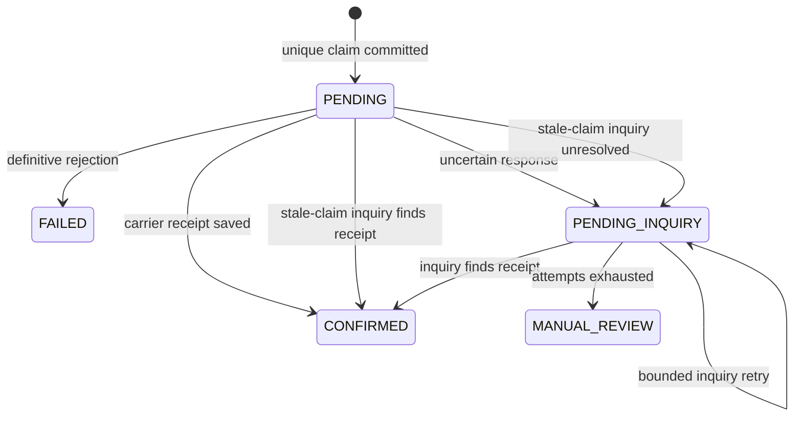

# Shipment booking: durable claims and inquiry-only recovery

## Scope

A local Java 17 / Spring MVC demo with two independent file-backed SQLite databases: application booking state and simulated carrier state. Enabled only by the `demo` profile. The fixed merchant comes from server configuration, not client input. No real shipment, charge, slot reservation, or carrier contract is created.

## Code organization

| Package | Responsibility |
| --- | --- |
| `booking.api` | Validation, trusted demo owner, HTTP status and safe error mapping |
| `booking.application` | Claim/replay orchestration, response snapshots, inquiry worker and scheduler |
| `booking.domain` | Immutable intent, state, owner, receipt, and response records |
| `booking.port` | Persistence, external carrier, and telemetry contracts |
| `booking.infrastructure.persistence` | SQLite/Hikari setup, schema initialization, atomic SQL and lease fencing |
| `booking.infrastructure.carrier` | HTTP submission/inquiry, deadlines, and disabled automatic write retries |
| `booking.infrastructure.monitoring` | Failure-isolated Micrometer observer; application code does not depend on metrics APIs |
| `demo.booking` | Independent durable fake carrier and clearly marked text labels |
| `booking.config` | Validated settings and explicit dependency composition |

See [shared code organization](code-organization.md) for quote/booking reuse and dependency rules.

## Flow

1. Normalize booking intent and calculate a SHA-256 fingerprint. Validate the owner-scoped opaque idempotency key.
2. Fast lookup: identical intent returns current state or the persisted terminal response; different intent returns conflict.
3. Insert the full intent, selected carrier, stable reference, and initial ownership lease using a targeted unique-key `ON CONFLICT ... DO NOTHING`. Only an inserted claim may make the initial submission. A losing request always follows the replay path, including `PENDING_INQUIRY`.
4. The insert commits before the HTTP call. Each persistence mutation is one atomic auto-committed statement; the coordinator rejects calls from an outer database transaction (`Propagation.NEVER`). No nested `REQUIRES_NEW` transaction or self-injection is required.
5. Persist either confirmation with its response snapshot, definitive rejection, or an uncertain state. A database save failure after carrier acceptance is not interpreted as a carrier failure; the durable claim remains recoverable.
6. A worker scans stale `PENDING` and due `PENDING_INQUIRY` rows, atomically claims a version/token-fenced lease, and performs inquiry only. A confirmed receipt closes the booking; absence or transient inquiry failure produces capped exponential backoff. After the attempt limit, the row becomes `MANUAL_REVIEW` rather than being resubmitted.

## State machine

Terminal response and state are updated together. A stale request/worker cannot overwrite a new owner's result because mutations require the expected version and lease token. Lease expiry grants permission to inquire, never permission to make another booking.

## SQLite choices

WAL supports concurrent readers with one writer; `synchronous=FULL` favors durable claims. Hikari supplies a small bounded connection pool; the busy timeout bounds write contention. Database locks and unrelated constraint errors produce a retryable storage error, not a false duplicate-key replay. Keys use binary comparison. UUID text IDs keep the demo simple; a production ID/sharding strategy is outside scope.

The two databases must live on local persistent storage; do not share WAL files across network-mounted replicas. Initial `schema-v1.sql` scripts initialize fresh demo databases, not a production migration system. Keep these files when restarting to demonstrate recovery. Their contents and WAL/SHM files are excluded from Git.

## Guarantee boundaries

- One initial application submission per durable owner/key claim, not one shipment per arbitrary order reference. Different keys represent different operations.
- Identical terminal POST replays return the saved response with the same HTTP status. GET uses HTTP 200 for a known operation regardless of its business state.
- The simulated carrier enforces its own stable-reference idempotency. A real adapter must verify its carrier's contract; local uniqueness cannot guarantee exactly-once external side effects by itself.
- No automatic resubmission, cancellation, refund, real quote authorization, FX/tax logic, or financial ledger is implemented. A confirmed operation has a simulated text label, not valid postage.
- `MANUAL_REVIEW` has no automated resolution endpoint in this iteration. An operator workflow is a follow-up; historical state is not silently rewritten.

## Monitoring and logs

`BookingObserver` separates outcomes and timings from Micrometer. Its implementation catches recording failures. Metrics use bounded operation/status labels; raw idempotency keys, ownership details, parcel data, and request IDs are not metric labels. Logs record booking IDs, carrier IDs, safe error types, state, and inquiry attempts. No request body or raw upstream response is logged.

References: [SQLite WAL](https://www.sqlite.org/wal.html), [targeted UPSERT](https://www.sqlite.org/lang_upsert.html), [Spring transactions](https://docs.spring.io/spring-framework/reference/data-access/transaction/declarative/tx-propagation.html).
