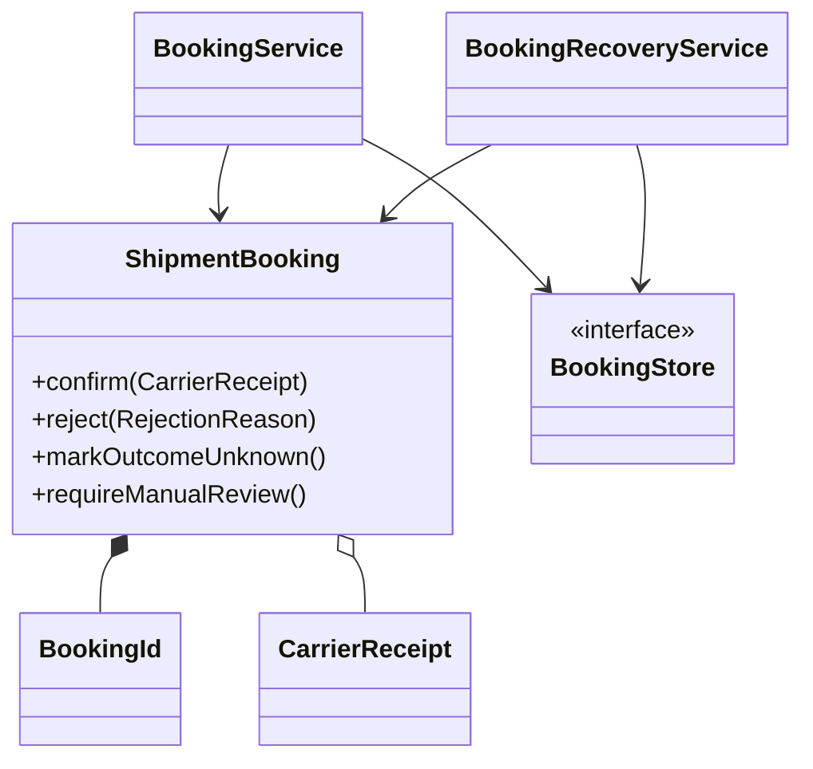
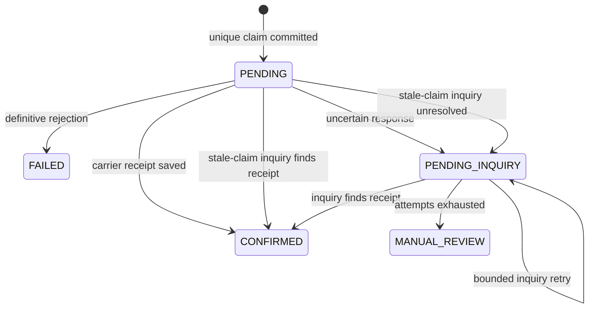

# Shipment booking: durable claims and inquiry-only recovery

## Scope

A local Java 17 / Spring MVC demo with two independent file-backed SQLite databases: application booking state and simulated carrier state. Business components are enabled through `shipping.booking.enabled`. The `demo` profile supplies the simulated carrier and fixed owner; outside it ownership requires an authenticated principal and a carrier port implementation. No real shipment, charge, slot reservation, or carrier contract is created.

## Code organization

| Package | Responsibility |
| --- | --- |
| `booking.api` | Input validation, trusted owner resolution, HTTP status and safe error mapping |
| `booking.application` | Claim/replay orchestration, intent hashing, booking-owned recovery interface |
| `booking.domain` | `ShipmentBooking` aggregate, lifecycle rules, identity, and immutable value/result records |
| `booking.port` | Persistence, external carrier, telemetry contracts, and `BookingRecord` storage snapshot |
| `booking.infrastructure.persistence` | SQLite/Hikari setup, schema initialization, atomic SQL and business version guards |
| `booking.infrastructure.security` | Authenticated principal to owner mapping outside the demo profile |
| `booking.infrastructure.monitoring` | Failure-isolated Micrometer observer; application code does not depend on metrics APIs |
| `reconciliation` | Independent task persistence, scheduling, inquiry and result delivery |
| `contracts.recovery` | Minimal discovery and observation contracts |
| `runtime` | Current deployment binding for booking and reconciliation |
| `demo.booking` | Simulated HTTP adapter, durable fake carrier, fault injection, fixed owner, and text labels |
| `booking.config` | Validated settings and explicit dependency composition |

See [shared code organization](code-organization.md) for quote/booking reuse and dependency rules.

## Domain model

`ShipmentBooking` is the aggregate root. Its identity, carrier, and reference cannot change. `confirm`, `reject`, `markOutcomeUnknown`, and `requireManualReview` own lifecycle transitions; there are no public state setters. Confirmation requires matching, complete carrier evidence. Invalid evidence leaves state unchanged. Unknown outcomes cannot be rejected as failures; confirmed, failed, and manual-review states reject further automated transitions.

`BookingId` is an identity value object. `CarrierReceipt` and `ShipmentParcel` remain immutable values; records are appropriate for these roles. `BookingResponse` is a read projection. The quote module keeps a lightweight model because fan-out coordination does not require a mutable aggregate.

Application services coordinate claim ownership, network calls and persistence. Reconciliation owns retry scheduling through a separate module. `BookingRecord` belongs to the storage port and rehydrates the aggregate; storage versions and the submission deadline are not aggregate fields. Persistence accepts an aggregate outcome and atomically saves its status, receipt fields, and error. The adapter checks identity and retains the business version guard.

An in-memory aggregate is request-local and cannot enforce distributed uniqueness. Winning the database claim remains the only authorization for initial submission; constructing or restoring an aggregate grants no permission to submit. SQLite uniqueness and conditional writes remain essential. Restored state is validated. Development schema changes require fresh local files.

## Flow

1. Normalize business intent, resolve country codes, validate the configured market, and calculate a SHA-256 fingerprint. Validate the owner-scoped opaque idempotency key.
2. Fast lookup: identical intent returns current state or the persisted terminal response; different intent returns conflict.
3. Insert the full intent, selected carrier, stable reference, and submission deadline and account-context reference using a targeted unique-key `ON CONFLICT ... DO NOTHING`. Only an inserted claim may make the initial submission. A losing request always follows the replay path, including `PENDING_INQUIRY`.
4. The insert commits before the HTTP call. Each persistence mutation is one atomic auto-committed statement; the coordinator rejects calls from an outer database transaction (`Propagation.NEVER`). No nested `REQUIRES_NEW` transaction or self-injection is required.
5. Persist either confirmed receipt fields, a definitive rejection, or an uncertain state. A database save failure after carrier acceptance is not interpreted as a carrier failure; the durable claim remains recoverable.
6. Independent reconciliation discovers overdue `PENDING` and `PENDING_INQUIRY` through a booking-owned interface. Its task table owns leases, inquiry attempts and retries. Normal bookings create no task. [Recovery design and database operations](reconciliation.md).

## State machine

All fields of a terminal business outcome are updated together. Responses are reconstructed from those fields. A stale request/worker cannot overwrite a new owner's result because booking mutations require the expected business version. Task mutations separately require task version and lease token. Recovery grants permission to inquire, never permission to submit again.

## SQLite choices

WAL supports concurrent readers with one writer; `synchronous=FULL` favors durable claims. Hikari supplies a small bounded connection pool; the busy timeout bounds write contention. Database locks and unrelated constraint errors produce a retryable storage error, not a false duplicate-key replay. Keys use binary comparison. UUID text IDs keep the demo simple; a production ID/sharding strategy is outside scope.

The two databases must live on local persistent storage; do not share WAL files across network-mounted replicas. Initial `schema-v1.sql` scripts initialize fresh demo databases, not a production migration system. Keep these files when restarting to demonstrate recovery. Their contents and WAL/SHM files are excluded from Git.

## Guarantee boundaries

- One initial application submission per durable owner/key claim, not one shipment per arbitrary order reference. Different keys represent different operations.
- Identical terminal POST replays reconstruct the same business result with the same HTTP status. GET uses HTTP 200 for a known operation regardless of its business state.
- The simulated carrier enforces its own stable-reference idempotency. A real adapter must verify its carrier's contract; local uniqueness cannot guarantee exactly-once external side effects by itself.
- No automatic resubmission, cancellation, refund, real quote authorization, FX/tax logic, or financial ledger is implemented. A confirmed operation has a simulated text label, not valid postage.
- `MANUAL_REVIEW` has no automated resolution endpoint in this iteration. An operator workflow is a follow-up; historical state is not silently rewritten.

## Monitoring and logs

`BookingObserver` separates outcomes and timings from Micrometer. Its implementation catches recording failures. Metrics use bounded operation/status labels; raw idempotency keys, ownership details, parcel data, and request IDs are not metric labels. Logs record booking IDs, carrier IDs, safe error types, state, and inquiry attempts. No request body or raw upstream response is logged.

References: [SQLite WAL](https://www.sqlite.org/wal.html), [targeted UPSERT](https://www.sqlite.org/lang_upsert.html), [Spring transactions](https://docs.spring.io/spring-framework/reference/data-access/transaction/declarative/tx-propagation.html).

## Business columns and indexes

`shipment_bookings` stores order reference, carrier/service, postal/country fields, normalized kg/cm measurements, and receipt/outcome fields. It has no request/response JSON columns. `BookingRecord.intent` is reconstructed from these columns; `BookingResponse` is projected from persisted aggregate state. `BookingRequestHasher` uses deterministic serialization only to calculate SHA-256, not as a storage format.

SQLite measurements use canonical decimal TEXT with `BigDecimal` reconstruction. NUMERIC/REAL coercion could lose precision and change the meaning of a normalized intent; text here represents a numeric business value, not an opaque payload. No numeric range queries on measurements are currently needed.

| Access path | Index | Reason |
| --- | --- | --- |
| Owner + idempotency key | Unique `(owner_type, owner_id, idempotency_key)` | Lookup plus distributed claim protection |
| Booking ID + owner checks | Primary key `(booking_id)` | Find at most one row, then verify owner |
| Fenced updates | Primary key `(booking_id)` | Business version/status predicates check that row |
| Carrier reference | Unique `(customer_reference)` | Prevent ambiguous reference ownership |
| Recovery discovery | Partial `(created_at, booking_id, submission_deadline_at)` for PENDING/PENDING_INQUIRY | Keyset sweep excludes terminal bookings |

Reconciliation owns its own task indexes. [Independent recovery design](reconciliation.md) explains transaction boundaries, failure handling and volume limits.
