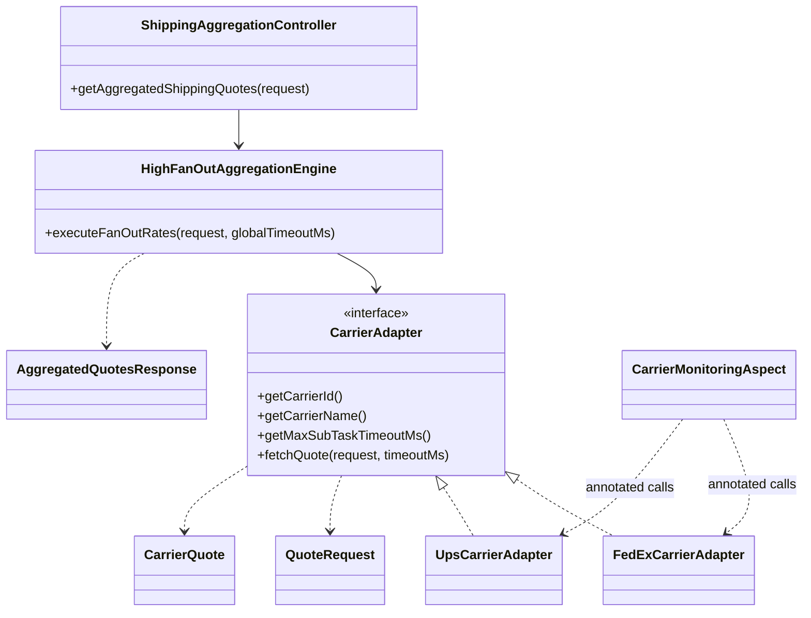

# Existing rate module: class structure and request flow

Read from the supplied source on October 18, 2026. This maps the reviewed Java 17 demo, not ShipTime's internal code. Build, 14 tests, and local demo smoke checks have passed; see [validation results](../summaries/java17.md).

## Class structure



DTO records are nested inside `ShipmentDTO`. Configuration, response wrappers, exception handling, and mock endpoints are omitted to keep the diagram focused.

## Current request sequence

```mermaid
sequenceDiagram
    participant Client
    participant Controller
    participant Engine
    participant Adapter
    participant Mock as Local mock carrier
    Client->>Controller: POST /api/shipping/quotes
    Controller->>Engine: request + configured global timeout
    loop Each registered adapter, scheduled concurrently
        Engine->>Adapter: fetchQuotes(request, remaining timeout)
        Adapter->>Mock: HTTP rate request
        Mock-->>Adapter: carrier-shaped response
        Adapter-->>Engine: Service quotes or exception
    end
    Note over Engine: Collect completed results on completion or deadline; cancel unfinished tasks
    Engine-->>Controller: quotes, typed outcomes, request ID, elapsed time
    Controller-->>Client: ApiResponse
```

## Code navigation

| Concern | Source |
| --- | --- |
| API entry | [ShippingAggregationController](../../src/main/java/com/enterprise/shipping/controller/ShippingAggregationController.java) |
| Scheduling, collection, fallback | [HighFanOutAggregationEngine](../../src/main/java/com/enterprise/shipping/engine/HighFanOutAggregationEngine.java) |
| Carrier contract | [CarrierAdapter](../../src/main/java/com/enterprise/shipping/adapter/CarrierAdapter.java) |
| Translation and outbound calls | [FedEx adapter](../../src/main/java/com/enterprise/shipping/adapter/FedExCarrierAdapter.java), [UPS adapter](../../src/main/java/com/enterprise/shipping/adapter/UpsCarrierAdapter.java) |
| Request and response records | [ShipmentDTO](../../src/main/java/com/enterprise/shipping/dto/ShipmentDTO.java) |
| Cross-cutting measurements | [CarrierMonitoringAspect](../../src/main/java/com/enterprise/shipping/monitoring/CarrierMonitoringAspect.java) |

## Boundary between current code and proposed product

Current code has two mock-backed integrations, one package's postal codes and measurements, per-adapter service mapping, deterministic CAD ranking, and bounded concurrent collection. It does not establish production carrier compatibility or a complete merchant pricing model.

The proposed comparison contract adds business concerns such as eligible account selection, price completeness, multiple service options, freshness, and explicit outcome categories. Those additions require later review and implementation decisions. Tests cover carrier worker isolation, deadlines, and HTTP timeout cleanup. Local smoke timings are recorded in the validation summary; no production throughput or P99 guarantee is claimed.

Markdown with Mermaid keeps these diagrams readable on GitHub and versioned beside the code. No external diagram editor is required.
