# System Component Architecture, Module Boundaries & Design Principles

**Date:** 2026-10-24  
**Status:** Implemented & Enforced by Automated Architectural Fitness Tests (`ModuleBoundariesTest`)

---

## 1. Architectural Purpose & Core Design Principles

The **Multi-Carrier Shipping Service** is architected as a **Modular Monolith with Hexagonal (Ports & Adapters) Intra-Module Layering**. Its primary structural goal is to deliver the operational simplicity of a single deployable Spring Boot artifact today while maintaining **strict compile-time and data-level boundaries** so that any bounded context (`auth`, `quote`, `booking`, `reconciliation`) can be extracted into an independent microservice tomorrow without rewriting domain or application logic.

### Six Governing Principles

1. **Unidirectional Dependency, Acyclic Dependencies Principle (ADP) & Dependency Inversion Principle (DIP)**
   - Package and module dependencies strictly form a **Directed Acyclic Graph (DAG)** with zero circular or reverse dependencies (**Unidirectional Dependency**).
   - Following Clean/Hexagonal Architecture's **Dependency Rule**, outer technical layers (`api`, `infrastructure`) depend inward on core business layers (`application`, `domain`, `port`, `contract`), never the reverse. When core logic requires persistence or external HTTP calls, it defines an internal `port` interface and inverts the dependency via **DIP**.

2. **Vertical Bounded-Context Decomposition (High Intra-Module Cohesion)**
   - Code is organized at the top level by **business capability** (`auth`, `quote`, `booking`, `reconciliation`), never by horizontal technical layers (`controllers/`, `services/`, `repositories/`).
   - Every business rule, state transition, repository query, and metric observer belonging to a capability lives inside that module's package tree.

3. **Inter-Module Decoupling via Published `contract` Interfaces Only**
   - Business modules **never** import another module's `domain`, `application`, `port`, `infrastructure`, `api`, or `config` packages.
   - Cross-module collaboration occurs exclusively through immutable DTOs and interfaces in the owning module's `contract` package:
     - `booking` $\rightarrow$ `quote.contract.QuoteSelectionPort`
     - `reconciliation` $\rightarrow$ `booking.contract.ShipmentRecoveryPort` & `booking.contract.ManualReviewReason`
   - When extracting microservices, an in-process `contract` implementation is replaced by an HTTP/gRPC/message-bus client without touching the consumer's business logic.

4. **Strict Database Table Ownership (Zero Cross-Module Joins)**
   - Even when sharing a single physical RDBMS/SQLite database in local deployment, each module has **exclusive read/write ownership** of its tables:
     - `quote` owns `shipment_requests` and `shipment_quotes`.
     - `booking` owns `shipment_bookings`.
     - `reconciliation` owns `booking_reconciliation_tasks`.
   - Modules store only logical foreign identifiers (`request_id`, `quote_id`, `booking_id`) across boundaries. There are **no cross-module SQL `JOIN`s** and **no cross-module foreign keys**, enabling a zero-downtime transition to **Database-per-Service**.

5. **Bidirectional External Provider Isolation (`provider.sandbox` vs. Consumer Ports)**
   - External shipping aggregators (such as ShipTime) and direct carriers are isolated in `provider/sandbox/`.
   - Business cores (`domain`, `application`, `port`, `contract`) do not import `provider.*`. Conversely, `provider.*` does not import any business module (`quote`, `booking`, `reconciliation`, `auth`).
   - Consumer-owned thin adapters (`quote.infrastructure.provider.SandboxRateAdapter`, `booking.infrastructure.provider.SandboxShipmentAdapter`, `booking.infrastructure.provider.SandboxLabelAdapter`, `reconciliation.infrastructure.provider.SandboxRecoveryAdapter`) translate between consumer ports and provider models, assembled solely in the `runtime` composition root.

6. **Framework-Free Domain & Transport-Agnostic Error Model**
   - `domain`, `application`, `port`, and `contract` layers do not depend on Web/HTTP framework types (`org.springframework.http.HttpStatus` or `shared.api`).
   - Application and transport errors use `shared.domain.ShippingException` (carrying bounded domain error codes and numeric status categories), which is mapped to HTTP responses exclusively at the outer REST boundary (`shared.api.ShippingExceptionHandler`).

---

## 2. System Module Architecture Diagrams

### 2.1 High-Level Module Hierarchy & Inter-Module Relationships (Mermaid)

```mermaid
flowchart TB
    subgraph Client["Browser Client (Single-Screen 3-Tab Workstation)"]
        UI["HTML5 / CSS3 / Vanilla JS\n(Guest Token + 24h Draft + Carrier Progress)"]
    end

    subgraph WebBoundary["HTTP Security & Diagnostics Boundary"]
        Trace["shared.api\nShippingRequestTracingFilter\nShippingExceptionHandler"]
        AuthFilter["auth.infrastructure\nShippingAuthenticationFilter"]
    end

    subgraph BusinessModules["Vertical Business Bounded Contexts (Modular Monolith)"]
        direction LR

        subgraph AuthMod["auth Module"]
            AuthAPI["auth.api\nShippingAuthController"]
            AuthApp["auth.application\nGuestSessionTokenService"]
        end

        subgraph QuoteMod["quote Module"]
            QuoteAPI["quote.api\nShippingQuoteController"]
            QuoteApp["quote.application\nQuoteApplicationService"]
            QuoteContract["quote.contract\nQuoteSelectionPort"]
            RatePort["quote.port\nRateComparisonPort"]
            SingleEngine["quote.application\nSingleProviderRateEngine"]
            FanOutEngine["quote.application\nHighFanOutAggregationEngine"]
            QuoteStore["quote.infrastructure.persistence\nJdbcQuoteStore"]
            QuoteBridge["quote.infrastructure.provider\nSandboxRateAdapter"]
        end

        subgraph BookingMod["booking Module"]
            BookAPI["booking.api\nShippingBookingController"]
            BookApp["booking.application\nShipmentApplicationService\nShipmentRecoveryService"]
            BookContract["booking.contract\nShipmentRecoveryPort\nManualReviewReason"]
            BookDomain["booking.domain\nShipmentBooking"]
            BookStore["booking.infrastructure.persistence\nJdbcShipmentStore"]
            BookBridge["booking.infrastructure.provider\nSandboxShipmentAdapter\nSandboxLabelAdapter"]
        end

        subgraph ReconMod["reconciliation Module"]
            ReconApp["reconciliation.application\nPendingShipmentDiscovery"]
            ReconStore["reconciliation.infrastructure.persistence\nJdbcPendingTaskStore"]
            ReconBridge["reconciliation.infrastructure.provider\nSandboxRecoveryAdapter"]
        end
    end

    subgraph RuntimeRoot["Deployment Composition Root"]
        Runtime["runtime\nSandboxConfiguration"]
    end

    subgraph ProviderLayer["External Provider Protocol Layer"]
        ProviderClient["provider.sandbox\nSandboxProviderClient\nSandboxPayloadMapper"]
    end

    subgraph SharedKernel["shared Technical Foundation & Value Kernel"]
        SharedDomain["shared.domain\nShippingIntent / ShippingAddress\nShippingMarketPolicy / ShippingException"]
        SharedHttp["shared.infrastructure.http\nOutboundOperation / OutboundCallExecutor\nOutboundDeadline / CarrierHttpClientFactory"]
        SharedDB["shared.infrastructure.persistence\nShippingMigrations / UniqueConstraints\nSqliteDataSources"]
        SharedIdentity["shared.identity\nUserContext / TimeOrderedIds"]
    end

    subgraph Storage["Isolated Module Tables (ANSI SQL)"]
        QDB[("shipment_requests\nshipment_quotes")]
        BDB[("shipment_bookings")]
        RDB[("booking_reconciliation_tasks")]
    end

    UI --> Trace --> AuthFilter
    AuthFilter --> AuthAPI --> AuthApp
    AuthFilter --> QuoteAPI --> QuoteApp
    AuthFilter --> BookAPI --> BookApp

    %% Cross-module contract calls ONLY
    BookApp ==>|"Contract Call Only"| QuoteContract
    QuoteApp -.->|"implements"| QuoteContract
    ReconApp ==>|"Contract Call Only"| BookContract
    BookApp -.->|"implements"| BookContract

    %% Intra-module rate engine strategy
    QuoteApp --> RatePort
    SingleEngine -.->|"implements"| RatePort
    FanOutEngine -.->|"implements"| RatePort

    %% Persistence ownership
    QuoteApp --> QuoteStore --> QDB
    BookApp --> BookStore --> BDB
    ReconApp --> ReconStore --> RDB

    %% Provider bridges
    SingleEngine --> QuoteBridge
    BookApp --> BookBridge
    ReconApp --> ReconBridge

    QuoteBridge --> ProviderClient
    BookBridge --> ProviderClient
    ReconBridge --> ProviderClient
    Runtime -.->|"wires"| ProviderClient

    ProviderClient --> SharedHttp
    QuoteStore --> SharedDB
    BookStore --> SharedDB
    ReconStore --> SharedDB
```



---

### 2.2 Layered Architecture & Dependency Direction Diagram (ASCII)

```text
+---------------------------------------------------------------------------------------------------+
|                                   PRESENTATION & HTTP BOUNDARY                                    |
|  [shared.api.ShippingRequestTracingFilter]  -->  [auth.infrastructure.ShippingAuthenticationFilter]|
|  [auth.api.ShippingAuthController]  [quote.api.ShippingQuoteController]  [booking.api.Shipping...] |
|  [shared.api.ShippingExceptionHandler] (Maps domain ShippingException -> HTTP Status & JSON)       |
+-------------------------------------------------+-------------------------------------------------+
                                                  |
                                                  v
+---------------------------------------------------------------------------------------------------+
|                              BOUNDED CONTEXTS (BUSINESS MODULES)                                  |
|                                                                                                   |
|  +-----------------------+      quote.contract       +-----------------------------------------+  |
|  |     quote MODULE      | <======================== |             booking MODULE              |  |
|  |-----------------------|    QuoteSelectionPort     |-----------------------------------------|  |
|  | application:          |                           | application:                            |  |
|  |  - QuoteAppService    |                           |  - ShipmentApplicationService           |  |
|  |  - SingleProviderEng  |                           |  - ShipmentRecoveryService              |  |
|  |  - HighFanOutEngine   |                           | domain:                                 |  |
|  | domain:               |                           |  - ShipmentBooking (State Machine)      |  |
|  |  - RateRequest        |                           |  - CarrierReceipt / BookingStatus       |  |
|  |  - ShippingQuote      |                           | port:                                   |  |
|  | port:                 |                           |  - ShipmentStore / ShipmentProviderPort |  |
|  |  - QuoteStore         |                           |  - LabelProviderPort                    |  |
|  |  - RateComparisonPort |                           +--------------------+--------------------+  |
|  |  - CarrierRatePort    |                                                ^                       |
|  +-----------+-----------+                                                |                       |
|              |                                           booking.contract | ShipmentRecoveryPort  |
|              |                                                            | ManualReviewReason    |
|              |                                       +--------------------+--------------------+  |
|              |                                       |         reconciliation MODULE           |  |
|              |                                       |-----------------------------------------|  |
|              |                                       | application:                            |  |
|              |                                       |  - PendingShipmentDiscovery             |  |
|              |                                       | port:                                   |  |
|              |                                       |  - PendingTaskStore                     |  |
|              |                                       |  - RecoveryCapabilityPort               |  |
|              |                                       +--------------------+--------------------+  |
+--------------+------------------------------------------------------------+-----------------------+
               |                                                            |
               v                                                            v
+---------------------------------------------------------------------------------------------------+
|                        INFRASTRUCTURE ADAPTERS & RUNTIME COMPOSITION                              |
|  - Persistence: JdbcQuoteStore (shipment_requests/quotes), JdbcShipmentStore (shipment_bookings), |
|                 JdbcPendingTaskStore (booking_reconciliation_tasks)                               |
|  - Provider Bridges: SandboxRateAdapter, SandboxShipmentAdapter, SandboxLabelAdapter,             |
|                      SandboxRecoveryAdapter  ---wired by--->  [runtime.SandboxConfiguration]      |
+-------------------------------------------------+-------------------------------------------------+
                                                  |
                                                  v
+---------------------------------------------------------------------------------------------------+
|                       EXTERNAL PROVIDER CLIENT & SHARED FOUNDATION                                |
|  [provider.sandbox]: SandboxProviderClient, SandboxPayloadMapper, ProviderProperties, Models      |
|  [shared.infrastructure.http]: OutboundOperation, OutboundCallExecutor, OutboundDeadline          |
|  [shared.infrastructure.persistence]: ShippingMigrations, UniqueConstraints, SqliteDataSources    |
|  [shared.domain]: ShippingIntent, ShippingAddress, ShipmentParcel, ShippingException              |
|  [shared.identity]: UserContext, TimeOrderedIds (UUIDv7)                                          |
+---------------------------------------------------------------------------------------------------+
```

---

## 3. Intra-Module Hexagonal Structure (The Dependency Rule & DIP)

Inside each business module (`auth`, `quote`, `booking`, `reconciliation`), packages enforce **Strict Layered Unidirectional Dependency**, the **Acyclic Dependencies Principle (ADP)**, and the **Dependency Inversion Principle (DIP)**:

```text
api/  --->  application/  --->  domain/  <---  port/  <---  infrastructure/
                 |                               ^
                 +---------->  contract/  -------+
```

| Sub-package | Responsibility | Allowed Outbound Dependencies |
| --- | --- | --- |
| `api` | REST controllers (`ShippingQuoteController`, `ShippingBookingController`, `ShippingAuthController`) and HTTP request/response mapping. | Own `application`, `shared.domain`, `shared.identity`, Spring Web. |
| `application` | Use-case orchestration, idempotency claim-before-call coordination, transaction boundaries (`Propagation.NEVER` around remote calls), rate comparison strategies (`SingleProviderRateEngine`, `HighFanOutAggregationEngine`). | Own `domain`, `port`, `contract`, peer modules' `contract`, `shared.domain`, `shared.identity`. **Never imports `api` or `provider`.** |
| `contract` | Published Language exposed to peer modules (`QuoteSelectionPort`, `ShipmentRecoveryPort`, `ManualReviewReason`). | Self-contained immutable records/enums and `shared.domain`. **Never exposes internal entities or repositories.** |
| `domain` | Pure business invariants and state machines (`RateRequest`, `ShippingQuote`, `ShipmentBooking`, `ShippingIntentFingerprint`, `CarrierReceipt`). | Own `domain`/`contract` and `shared.domain`. **Zero Spring, JDBC, or HTTP imports.** |
| `port` | Inbound/outbound interfaces owned by the module (`QuoteStore`, `RateComparisonPort`, `RateProviderPort`, `CarrierRatePort`, `ShipmentStore`, `ShipmentProviderPort`, `LabelProviderPort`, `PendingTaskStore`, `RecoveryCapabilityPort`). | Own `domain` and `shared.domain`. **Never imports `application`, `api`, or `infrastructure`.** |
| `infrastructure` | Driven adapters implementing `port` interfaces: `persistence/` (ANSI SQL `Jdbc*Store`), `provider/` (`Sandbox*Adapter`), `monitoring/` (`Micrometer*Observer`), and servlet filters. | Own `port`, `domain`, `contract`, `provider.sandbox` (in provider bridges), and `shared.infrastructure`. |
| `config` | Module-local Spring `@Configuration` wiring repositories, observers, and application services. | Own module layers and `shared`. |

---

## 4. Top-Level Module Inventory & Responsibilities

| Module | Key Classes | Owned Tables | Purpose |
| --- | --- | --- | --- |
| **`auth`** | `ShippingAuthController`, `GuestSessionTokenService`, `ShippingAuthenticationFilter`, `ShippingAuthConfiguration` | *(Stateless HMAC)* | Issues 2-hour fingerprint-bound `HmacSHA256` guest tokens (`POST /api/auth/guest`), sets `SameSite=Strict; HttpOnly` cookies for label tab navigation, enforces same-origin writes, and resolves verified `userId` via `UserContext`. |
| **`quote`** | `ShippingQuoteController`, `QuoteApplicationService`, `SingleProviderRateEngine`, `HighFanOutAggregationEngine`, `RateRequest`, `ShippingQuote`, `QuoteSelectionPort`, `JdbcQuoteStore`, `SandboxRateAdapter` | `shipment_requests`, `shipment_quotes` | Persists canonical customer shipping intent (`Idempotency-Key` + `content_fingerprint`), executes version-fenced rate queries (via single provider or multi-carrier fan-out), stores returned offers atomically, and exposes `QuoteSelectionPort` to `booking`. |
| **`booking`** | `ShippingBookingController`, `ShipmentApplicationService`, `ShipmentRecoveryService`, `ShipmentBooking`, `ShipmentRecoveryPort`, `JdbcShipmentStore`, `SandboxShipmentAdapter`, `SandboxLabelAdapter` | `shipment_bookings` | Resolves bookable quotes, commits a durable `PENDING` claim before external dispatch, prevents duplicate submissions across concurrent threads/keys, transitions through `CONFIRMED` / `FAILED` / `PENDING_INQUIRY` / `MANUAL_REVIEW`, and fetches PDF labels on demand. |
| **`reconciliation`** | `PendingShipmentDiscovery`, `RecoveryCapabilityPort`, `JdbcPendingTaskStore`, `SandboxRecoveryAdapter`, `ShippingRecoveryConfiguration` | `booking_reconciliation_tasks` | Periodically scans overdue unresolved bookings via `ShipmentRecoveryPort` using keyset pagination, evaluates provider lookup capabilities via `RecoveryCapabilityPort`, registers deduplicated `PAUSED` tasks, and escalates unrecoverable bookings to `MANUAL_REVIEW`. |
| **`provider.sandbox`** | `SandboxProviderClient`, `SandboxPayloadMapper`, `ProviderProperties`, `ProviderModels` | *(None)* | Encapsulates external shipping aggregator HTTP protocol, Basic authentication, Imperial/Metric payload normalization, and isolated `rates` / `create` / `labels` connection pools, bulkheads, and circuit breakers. |
| **`runtime`** | `SandboxConfiguration` | *(None)* | Deployment composition root that wires `SandboxProviderClient` into consumer-owned provider adapters (`SandboxRateAdapter`, `SandboxShipmentAdapter`, `SandboxLabelAdapter`, `SandboxRecoveryAdapter`). |
| **`shared`** | `ShippingIntent`, `ShippingAddress`, `ShippingMarketPolicy`, `ShippingException`, `UserContext`, `TimeOrderedIds`, `OutboundOperation`, `OutboundCallExecutor`, `OutboundDeadline`, `ShippingMigrations`, `UniqueConstraints`, `ShippingExceptionHandler`, `ShippingRequestTracingFilter` | `schema_migrations` | Reusable technical foundation: UUIDv7 generation, Canadian postal/market policy, domain error representation, resilient HTTP execution primitives, SHA-256 verified schema migrations, and ANSI SQL constraint helpers. |

---

## 5. Automated Architectural Fitness Functions (`ModuleBoundariesTest`)

To prevent architectural drift over time, `src/test/java/com/enterprise/shipping/shipping/ModuleBoundariesTest.java` enforces five source-level rules on every test run:

1. **`sharedDoesNotImportBusinessModulesOrConcreteProviders`**
   - `shared` never imports `auth`, `quote`, `booking`, `reconciliation`, `provider`, or `runtime`.
2. **`providerDoesNotImportBusinessModulesOrWebApiLayer`**
   - `provider` never imports `auth`, `quote`, `booking`, `reconciliation`, or `shared.api`.
3. **`businessCoreDoesNotImportProviderImplementationsOrWebApiLayer`**
   - No business module's `domain`, `application`, `port`, or `contract` layer may import `provider.*`, `shared.api.*`, or `org.springframework.http.HttpStatus`.
4. **`businessModulesCommunicateExclusivelyThroughPublishedContractPackages`**
   - No business module (`auth`, `quote`, `booking`, `reconciliation`) may import another business module's `api`, `application`, `domain`, `port`, `infrastructure`, or `config` package—only `contract` packages are permitted across modules.
5. **`domainAndPortLayersNeverDependUpwardOnApplicationApiOrInfrastructure`**
   - Within every business module, `domain`, `port`, and `contract` never import `application`, `api`, `infrastructure`, or `config`.

---

## 6. Microservice Extraction Path

Because the codebase enforces strict module and data boundaries today, splitting into microservices requires **zero domain or SQL refactoring**:

| Future Microservice | Extracted Packages | Owned Database Tables | Cross-Service Integration Change |
| --- | --- | --- | --- |
| **Auth / Edge Gateway Service** | `auth/*`, `shared/identity/*` | Stateless (HMAC / JWT) | Propagates verified `user_id` and `X-Request-Id` to downstream services. |
| **Quote Service** | `quote/*`, `provider/sandbox/*` | `shipment_requests`, `shipment_quotes` | Exposes `QuoteSelectionPort.resolve(userId, quoteId)` as an internal REST/gRPC endpoint. |
| **Booking Service** | `booking/*`, `provider/sandbox/*` | `shipment_bookings` | Calls Quote Service's `QuoteSelectionPort` client before committing local `PENDING` claim; exposes `ShipmentRecoveryPort` internally. |
| **Reconciliation Worker Service** | `reconciliation/*` | `booking_reconciliation_tasks` | Calls Booking Service's `ShipmentRecoveryPort` over internal RPC or consumes overdue-booking events. |
