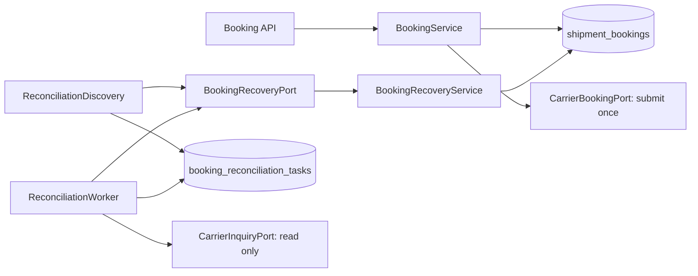

# Independent reconciliation module

Booking and reconciliation run in one process. Each owns its table and persistence port. Reconciliation imports only neutral recovery contracts, never booking repositories or domain classes. The runtime composition layer currently binds both tables to the same SQLite datasource.

## Tables and database operations

| Path | Booking table | Task table |
| --- | --- | --- |
| Normal success or rejection | Insert PENDING; update final outcome | No writes |
| Submission timeout | Update PENDING_INQUIRY | Discovered asynchronously |
| Process stops after claim/carrier acceptance | PENDING remains until submission deadline | Recurring discovery creates a task |
| Register recovery | Read unresolved candidates through booking port | Insert if absent by `(booking_locator, booking_id)` |
| Inquiry retry | First unknown transition only; later retries leave business version unchanged | Claim lease, persist observation, schedule retry |
| Carrier result found | Version-guarded status/receipt update | Persist evidence before delivery; delete after acknowledgement |
| Attempts exhausted | Transition to MANUAL_REVIEW | PAUSED task retained for investigation |

The booking row keeps business identity, intent, receipt, status, version and a submission deadline. It has no retry counter, next inquiry timestamp, or lease. `booking_locator` is an immutable logical routing reference, not an implemented shard router.

The task holds `carrier_id`, `carrier_context_reference`, and `customer_reference`, in addition to booking ID/locator. These identify the original carrier/account/attempt without joining the booking table. The context reference is a server-owned credential alias, never a credential. The simulator has one account; production account selection and credential resolution require a real adapter.

Task scheduling uses `available_at`: the next eligible time when waiting, or lease expiry while running/delivering. Task primary keys use UUIDv7 for insertion locality; lease tokens remain random UUIDv4 because they fence ownership rather than order inserts. The task also owns attempt count, lease token, version, safe error code and structured result fields. No request/response JSON or foreign key to the booking table is required.

## Recovery across failures

Booking status changes and task registration are deliberately **not** a cross-table transaction. Recurring discovery scans both PENDING_INQUIRY and overdue PENDING, so a task-storage failure or crash between steps remains discoverable. Keyset pagination wraps after each sweep, including old rows that become uncertain after the cursor has passed. The cursor advances only after every task registration in the page succeeds. Parallel discoveries deduplicate through a unique index.

Task claims and mutations use token/version compare-and-set. A takeover rejects stale task writes. Task ownership does not grant authority over booking state: the booking handler validates the original lookup identity and applies aggregate rules with its own business version. Repeated delivery of the same confirmed receipt is an acknowledgement without another business write; conflicting evidence is retained for review.

Carrier evidence is persisted **before** calling the booking port. If the booking update succeeds but its acknowledgement is lost, or task deletion fails, the saved observation is redelivered. Delivery retries do not consume another inquiry attempt or call the carrier again. Unresolved inquiries use capped exponential backoff; missing results never authorize submission. Manual-review tasks are paused, not automatically retried or deleted.

All current mutations are single SQL statements committed independently. Inquiry and booking-port calls occur outside database transactions. No distributed transaction, synchronous task write on the successful request path, automatic resubmission, or automatic refund is introduced.

## Indexes and volume

- Booking discovery: partial `(created_at, booking_id, submission_deadline_at)` index for PENDING/PENDING_INQUIRY. Completed rows leave the index. The keyset bounds and order avoid sorting; status/deadline filtering can still examine several open candidates.
- Task deduplication: unique `(booking_locator, booking_id)`.
- Due work: partial `(available_at, task_id)` index for WAITING/RUNNING/RESULT_PENDING. Paused tasks are excluded.
- Task mutations and booking outcome updates: primary-key lookup plus version/token guards.

JDBC tests inspect actual SQLite query plans. This is not evidence of throughput at hundreds of millions of rows. Production sizing must account for unresolved backlog, sweep duration, retention of terminal bookings/paused tasks, write contention and index maintenance. Task deletion bounds completed-task storage, but operator resolution, archival and retention jobs are not implemented. Discovery interval and batch size must be tuned together; an entire sweep can take multiple intervals.

## Runtime and future extraction

The demo enables `shipping.reconciliation.enabled`. `scheduling-enabled=false` disables both scheduled loops while leaving components available for tests. Discovery defaults to one page of 100 every 30 seconds; execution defaults to 16 eligible tasks every second. `shipping.booking.submission-deadline-ms` defaults to 15 seconds and must exceed the submit timeout. Separate `shipping.reconciliation.*` settings control inquiry timeout, lease, backoff and attempt limit.

A future process can own the task datasource and carrier inquiry adapters, replacing the in-process `BookingRecoveryPort` with an authenticated HTTP/MQ boundary. Discovery and idempotent observation delivery already define that seam. Service deployment, remote authentication, transport budgets, sharded routing and production database migration remain future work. SQLite WAL files must remain local; this demo does not support multiple application hosts sharing a file.

Metrics use bounded operation/outcome enums through a failure-isolated observer. Logs include task/booking identifiers and safe failure types, without parcel data, keys, credentials or raw carrier payloads.
