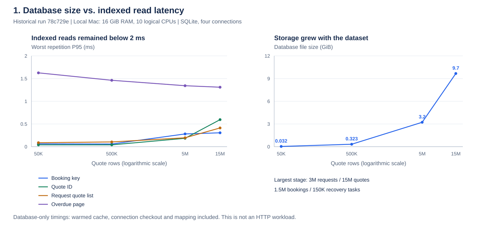
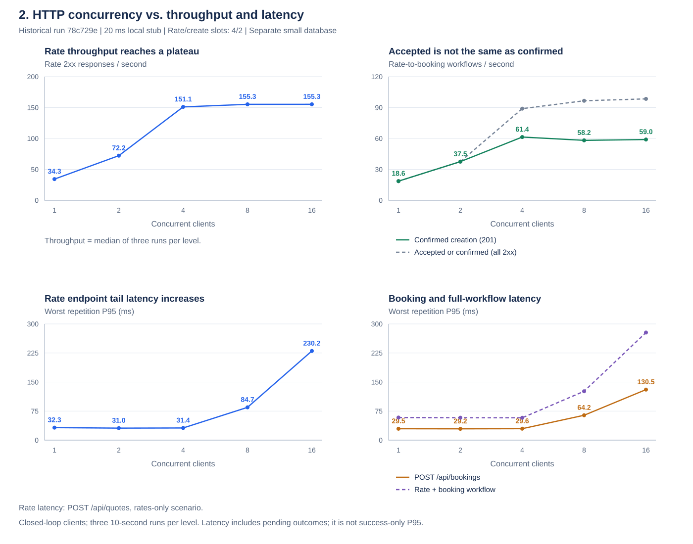
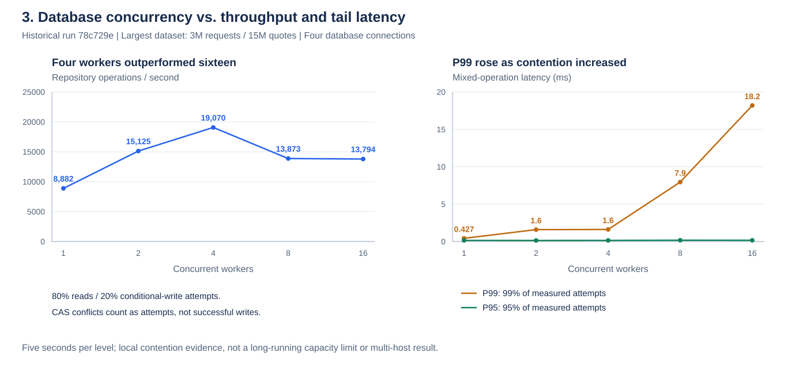

# Local shipping load-test report

Tested version: `78c729e` · SQLite only · Execution complete

**Subsequent backend fix:** proven local creation admission failures now use `RETRYABLE` with a same-key CAS retry instead of entering inquiry. Targeted regression coverage was added. The measurements and findings below describe the original run; the full load suite has not been rerun after the fix. Historical pending rows are not automatically reclassified.

## 1. Summary: what did we learn?

**The indexed database reads stayed fast at 15 million quotes. Higher HTTP concurrency reached a throughput plateau, and exposed a booking failure-classification issue.**

| Question | Result | Meaning |
| --- | --- | --- |
| Can the database handle a large history? | 3M requests, 15M quotes, 1.5M bookings and 150K recovery tasks; 9.67 GiB | The largest dataset completed the measured query and correctness checks. |
| Were the main queries still fast? | Warmed P95: booking key 0.31 ms; quote ID 0.60 ms; request quotes 0.41 ms; overdue discovery 1.31 ms | Database-only timings include connection checkout and row mapping; they are not HTTP response times. |
| How much HTTP traffic was processed? | About 155 fresh rate requests/s; up to 61.4 confirmed rate-to-booking workflows/s | These are observed results with a local 20 ms provider and deliberately small concurrency limits. |
| Did more clients always help? | No. Confirmed workflow throughput plateaued around four clients | More concurrency increased waiting/contention rather than completed shipments. |
| Did the reliability checks pass? | Concurrent idempotency, payload conflict, failed-rate retry and lost-create-response checks passed | The exercised scenarios did not produce duplicate provider creation calls. |
| What needs improvement? | 3,173 bookings ended in `PENDING_INQUIRY` under load | Known local admission failures appear to be treated as uncertain external outcomes. This requires a follow-up fix. |

**Acceptance:** measured database latency and correctness checks passed. The load run completed, but it does not establish production capacity or resolve the pending-booking issue. HTTP `202` is pending, not a confirmed shipment.

### Visual summary

These figures use recorded results from **`78c729e`**, before the booking admission fix. They do not represent a new load run. Database-scale and HTTP-concurrency tests are separate experiments; they do not establish HTTP capacity at the largest dataset.

**A. Data volume → database latency and storage.** The quote count grows from 50K to 15M. The four plotted warmed P95 reads remain below 2 ms, while storage grows to 9.67 GiB. The horizontal axis is logarithmic; connecting lines show sampled trends, not predictions between points.

[](figures/database-scale.svg)

**B. Request pressure → HTTP throughput and latency.** At four clients, rates approach their measured throughput plateau and confirmed workflows reach about 61/s. Beyond four clients, latency rises without a comparable increase in completed work. The green line counts confirmed creations; the dashed gray line includes pending `202` responses. The bottom-right panel separates booking endpoint latency from the complete rate-to-booking workflow. Latencies include all sampled outcomes, not only successful creation.

[](figures/http-concurrency.svg)

**C. Database concurrency → processing rate and tail latency.** On the largest dataset, four workers process about 19K repository operations/s, versus about 14K at sixteen workers. P99 grows from about 1.6 ms at four workers to 18.2 ms at sixteen. Operations include reads and conditional-write attempts, including expected CAS conflicts; they are not shipment completions.

[](figures/database-concurrency.svg)

The images are standalone SVGs; click to enlarge. Their numeric input is saved in [chart-data.json](chart-data.json), aggregated from the original result files. See the generation command at the end of this report.

## 2. Test resources and configuration

| Resource | Configuration used |
| --- | --- |
| Machine | Local Mac, 16 GiB RAM, 10 logical CPUs |
| Deployment | Application, database, provider stub and load generator shared the machine; no dedicated production server |
| Runtime | Homebrew OpenJDK 17.0.19; Java probes had a 768 MiB heap ceiling |
| Database | SQLite; WAL, FULL synchronous mode and foreign keys enabled; four application connections |
| SQLite versions | Python seeder 3.53.1; JDBC driver 3.53.4 |
| External service | Local loopback provider stub, approximately 20 ms delay; no real sandbox calls or charges |
| Outbound limits | At most four simultaneous rate calls and two create calls, configured for this test |
| Users | Large synthetic dataset: 1,000 users; HTTP traffic: one authenticated guest |
| Isolation | Temporary databases; demonstration database and credentials were not used |
| Disk safeguards | Keep at least 15 GiB free; cap run artifacts at 22 GiB |

Maximum observed HTTP heap snapshot was 184.6 MiB. This was not a continuously sampled process-memory peak. CPU measurements combine the application, stub and load generator, so they do not isolate server CPU cost.

## 3. Method: what was run, and in what order?

1. **Build realistic indexed history.** Grow one isolated database through 10K, 100K, 1M and 3M requests, with quotes, bookings and recovery tasks. Keep indexes and durability enabled.
2. **Measure database reads at each size.** Exercise the production JDBC repositories, including ownership checks and hit/miss lookups. Run three warmed repetitions of at least 1,000 operations per scenario. Check query plans.
3. **Measure database contention at each size.** Run 1, 2, 4, 8 and 16 workers for five seconds each, mixing 80% reads with 20% conditional-update attempts. Verify state versions and count conflicts separately from errors.
4. **Measure HTTP concurrency separately.** Use a separate small database and the real authenticated application with the local provider stub. Test status, fresh rates and rate-to-booking workflows at 1, 2, 4, 8 and 16 clients. Each combination runs three times for ten seconds after warmup: 45 measured runs, 450 seconds in total.
5. **Inject failures and verify recovery.** Check concurrent duplicate submissions, conflicting payloads, rate retries and a deliberately lost create response. Compare durable booking states with provider call counts.
6. **Audit the largest database.** Inspect 12 indexed access patterns and run a separate conditional-write latency probe.

HTTP clients are **closed-loop**: each client waits for its operation to finish before sending the next. The test increases concurrent clients, rather than forcing a fixed requests-per-second arrival rate. HTTP tests were not run against the 15M-quote database; database scale and HTTP concurrency were measured separately.

How to read the figures:

- **P95 / P99:** 95% / 99% of measured operations completed within that time. Tables use the worst repetition where stated.
- **Ops/s:** repository operations per second, not complete business workflows.
- **CAS conflict:** an expected optimistic-concurrency loss; another update won. It is counted separately from database errors.
- **2xx responses:** includes accepted/pending outcomes. Only `CONFIRMED` counts as completed creation.

Read budgets were P95 below 10 ms for point lookups, 20 ms for request quote lists, and 50 ms for a 100-row discovery page. The separate uncontended write-attempt P95 budget was 20 ms. These are local test budgets, not product SLAs.

## 4. Detailed results

### 4.1 Dataset size and preparation time

| Requests | Quotes | DB MiB | Build seconds¹ | Correctness | Latency budgets |
| ---: | ---: | ---: | ---: | --- | --- |
| 10,000 | 50,000 | 33.2 | 1.3 | True | True |
| 100,000 | 500,000 | 330.8 | 21.8 | True | True |
| 1,000,000 | 5,000,000 | 3303.5 | 522.2 | True | True |
| 3,000,000 | 15,000,000 | 9901.8 | 1362.3 | True | True |

¹ Incremental growth from the preceding stage, including analysis/checkpoint. Build measurements use the documented preparation cache.

### 4.2 Database read latency

P95 below is the worst of three 1,000-operation repetitions, including connection checkout and row mapping.

| Requests | Booking key P95 ms | Quote ID P95 ms | Request quotes P95 ms | Discovery P95 ms |
| ---: | ---: | ---: | ---: | ---: |
| 10,000 | 0.063 | 0.040 | 0.087 | 1.626 |
| 100,000 | 0.059 | 0.040 | 0.104 | 1.462 |
| 1,000,000 | 0.281 | 0.185 | 0.196 | 1.343 |
| 3,000,000 | 0.306 | 0.595 | 0.413 | 1.310 |

### 4.3 Concurrent database reads and writes

80% reads / 20% CAS attempts; five seconds per concurrency level. CAS conflicts are expected; version accounting must remain exact.

| Requests | Workers | Ops/s | P95 ms | P99 ms | CAS applied | CAS conflicts | Other errors |
| ---: | ---: | ---: | ---: | ---: | ---: | ---: | --- |
| 10,000 | 1 | 9099 | 0.184 | 0.297 | 9100 | 0 | none |
| 10,000 | 2 | 17920 | 0.154 | 0.268 | 16916 | 1010 | none |
| 10,000 | 4 | 24227 | 0.142 | 1.349 | 19535 | 4722 | none |
| 10,000 | 8 | 23247 | 0.156 | 7.643 | 18176 | 5129 | none |
| 10,000 | 16 | 22603 | 0.153 | 18.038 | 17871 | 4736 | none |
| 100,000 | 1 | 9814 | 0.142 | 0.184 | 9816 | 0 | none |
| 100,000 | 2 | 17988 | 0.145 | 0.241 | 17180 | 809 | none |
| 100,000 | 4 | 14709 | 0.146 | 3.842 | 12113 | 2878 | none |
| 100,000 | 8 | 17414 | 0.369 | 7.474 | 13194 | 4340 | none |
| 100,000 | 16 | 19244 | 0.221 | 20.221 | 14502 | 4825 | none |
| 1,000,000 | 1 | 8800 | 0.159 | 0.340 | 8801 | 0 | none |
| 1,000,000 | 2 | 18509 | 0.141 | 0.159 | 17767 | 743 | none |
| 1,000,000 | 4 | 23238 | 0.147 | 1.353 | 18751 | 4498 | none |
| 1,000,000 | 8 | 20368 | 0.189 | 7.301 | 15610 | 4970 | none |
| 1,000,000 | 16 | 22398 | 0.175 | 17.207 | 17307 | 5142 | none |
| 3,000,000 | 1 | 8882 | 0.147 | 0.427 | 8883 | 0 | none |
| 3,000,000 | 2 | 15125 | 0.141 | 1.591 | 13407 | 1719 | none |
| 3,000,000 | 4 | 19070 | 0.147 | 1.611 | 15644 | 3501 | none |
| 3,000,000 | 8 | 13873 | 0.170 | 7.949 | 11021 | 2857 | none |
| 3,000,000 | 16 | 13794 | 0.163 | 18.201 | 11235 | 2648 | none |

### 4.4 HTTP requests and workflows

Actual authenticated application, local 20 ms provider stub; rate/create bulkheads are configured to 4/2 for this test. Each row summarizes three ten-second repetitions. Success throughput is the median; P95 is the worst repetition and includes accepted and rejected responses.

| Scenario | Workers | 2xx responses/s | Total responses | 503 capacity responses | Worst P95 ms |
| --- | ---: | ---: | ---: | ---: | ---: |
| status | 1 | 2660.2 | 82113 | 0 | 1.22 |
| status | 2 | 8002.3 | 238176 | 0 | 0.52 |
| status | 4 | 13158.5 | 393871 | 0 | 0.42 |
| status | 8 | 19211.5 | 576694 | 0 | 0.58 |
| status | 16 | 17629.3 | 523798 | 0 | 2.52 |
| rates | 1 | 34.3 | 1032 | 0 | 32.31 |
| rates | 2 | 72.2 | 2176 | 0 | 31.03 |
| rates | 4 | 151.1 | 4530 | 0 | 31.43 |
| rates | 8 | 155.3 | 4674 | 0 | 84.68 |
| rates | 16 | 155.3 | 4697 | 0 | 230.20 |
| workflow | 1 | 18.6 | 557 | 0 | 58.34 |
| workflow | 2 | 37.5 | 1131 | 0 | 57.93 |
| workflow | 4 | 88.9 | 2670 | 0 | 57.72 |
| workflow | 8 | 96.6 | 2924 | 0 | 126.15 |
| workflow | 16 | 98.4 | 2953 | 0 | 277.78 |

Endpoint/workflow latency breakdown from the same raw HTTP runs. Rate endpoint values are from the rates-only scenario; booking and workflow values are from the rate-to-booking scenario. Each P95 is the worst of three repetitions, not a pooled or success-only percentile.

| Clients | Confirmed workflows/s (median) | POST /api/quotes P95 ms | POST /api/bookings P95 ms | Rate + booking workflow P95 ms |
| ---: | ---: | ---: | ---: | ---: |
| 1 | 18.6 | 32.31 | 29.45 | 58.34 |
| 2 | 37.5 | 31.03 | 29.21 | 57.93 |
| 4 | 61.4 | 31.43 | 29.60 | 57.72 |
| 8 | 58.2 | 84.68 | 64.25 | 126.15 |
| 16 | 59.0 | 230.20 | 130.48 | 277.78 |

Reliability assertions: `concurrent_rate_idempotency`=True, `concurrent_booking_idempotency`=True, `payload_conflict`=True, `failed_rate_retry`=True, `uncertain_creation_no_retry`=True.
Post-load recovery: **True**. Availability classification: **True**.

HTTP booking states at completion: `[{"status": "CONFIRMED", "rows": 7083}, {"status": "MANUAL_REVIEW", "rows": 1}, {"status": "PENDING_INQUIRY", "rows": 3173}]`.

Confirmed bookings: **7083**; simulated provider create calls: **7084**. One deliberately lost creation response is expected. HTTP 202 means accepted/pending, not confirmed shipment success.

### 4.5 Conditional-write latency

Includes version read, domain restoration, conditional update and commit. Three five-second repetitions per level; reads and writes have separate distributions. The 20 ms target is an initial uncontended P95 budget.

| Workers | Worst write-attempt P95 ms | Worst write-attempt P99 ms |
| ---: | ---: | ---: |
| 1 | 0.247 | 0.440 |
| 4 | 1.376 | 3.908 |
| 16 | 3.842 | 34.522 |

CAS probe correctness: **True**.

### 4.6 Index audit

- `query-plans-3000000.json`: 12 access patterns; all indexed: **True**. UPDATE statements were explained only.

## 5. Findings and required follow-up

All four dataset stages passed the measured warmed-read latency budgets, ownership checks and CAS version accounting. No SQLite busy/pool errors were recorded in the mixed repository runs. This is a local regression acceptance, not a production capacity certification.

The application catches all provider runtime failures after claiming a booking and marks the outcome unknown (`ShipmentApplicationService`, provider-create catch). Under the configured create bulkhead of two, the run produced 3173 pending-inquiry rows while confirmed rows matched simulated provider calls minus the one deliberately lost response. This is consistent with local pre-dispatch rejection being treated as remote uncertainty. Separate known admission rejection from genuinely ambiguous outcomes in a future design review; do not introduce blind creation retries. Production code was not changed.

Confirmed creation throughput under the test configuration:
- 1 clients: median 18.6 confirmations/s.
- 2 clients: median 37.5 confirmations/s.
- 4 clients: median 61.4 confirmations/s.
- 8 clients: median 58.2 confirmations/s.
- 16 clients: median 59.0 confirmations/s.

Higher client concurrency did not increase confirmed throughput beyond four clients. HTTP 202 must not be counted as a completed shipment.
At the largest dataset, mixed repository throughput was 19070 ops/s at four workers and 13794 at sixteen. More workers increased contention rather than capacity; retain bounded admission and size from measured throughput.
End-to-end wall elapsed time: 94.4 minutes; recorded incremental seeding/analysis/count/checkpoint stages sum to 31.8 minutes. These timers have different scopes. Original finalization also walked page-allocation metadata; host pauses were not separately instrumented. The reusable runner now reuses the JDBC allocation results instead of repeating that walk in Python.
Peak observed run artifacts: 9.79 GiB, below the 22 GiB cap. The 15 GiB free-space guard did not trigger.
Maximum observed HTTP heap snapshot: 184.6 MiB (not a continuously sampled process-memory peak). CPU values in raw results combine application, stub and load generator in one JVM.

The executed run captured its regular plans at every scale and the supplementary 12-pattern audit at the final scale. A separate CAS probe was run afterward. Reusable tooling now invokes these audit/probe hooks automatically; the larger stages were not rerun merely to exercise those hooks.


## 6. Limits of these results

- Mac: 16 GiB RAM, 10 logical CPUs; application, driver, stub and load client share the host.
- Java runtime: Homebrew OpenJDK 17.0.19; Java probes use a 768 MiB heap ceiling.
- HTTP uses one authenticated guest; the volume dataset spans 1,000 synthetic users. Historical seed dates are fixed; expiry transitions are not stress-tested by the point-lookup benchmarks.
- Seed SQLite: 3.53.1; JDBC SQLite: 3.53.4.
- WAL/FULL and foreign keys enabled; four application database connections.
- Warmed OS cache; first-pass samples are separately recorded, not true cold-cache measurements.
- Four application tables; task due scans are synthetic index probes, not a claim of an active lease-based recovery consumer.
- No real sandbox, financial charges, frontend changes, production database changes or MySQL/PostgreSQL validation.
- HTTP is closed-loop; saturation results include configured fast rejection. Aggregate latency cannot establish success-only tail latency under overload.
- HTTP-only test budgets: rates 7 s, create/read 1 s; automatic recovery discovery interval 1 h, with one explicit discovery check for the injected unknown outcome. These differ from production defaults and isolate each measurement.
- Single-process repository contention does not prove multi-process or multi-host behavior.

Raw artifacts: `/tmp/shipping-load-full-20261025`. Databases are not committed.

Tooling validation: the final Small-only run passed its seed, JDBC, plan-audit and CAS checks. A report-export formatting error was corrected and the export step rerun successfully; the database measurements were not repeated.

## 7. Reproduce the test and locate the evidence

From the repository root, with Java 17, Python 3 and the Maven wrapper available:

```sh
# Small dataset for a quick database check; does not run HTTP load.
./tests/performance/run.sh /tmp/shipping-load-small-new 10000

# All dataset stages, plus HTTP load at the Medium stage.
./tests/performance/run.sh /tmp/shipping-load-full-new 3000000
```

Use a new output directory for each run. The commands use the current checkout; the recorded results above belong to `78c729e`. The final reusable harness includes audit/report improvements added after the original execution; those additions were checked separately at Small scale.

| Evidence | Original location |
| --- | --- |
| Raw results directory | `/tmp/shipping-load-full-20261025` |
| Dataset size and preparation | `seed-results.json` |
| Database results by size | `database-10000.json` through `database-3000000.json` |
| HTTP workload results | `http/http-results.json` |
| Final booking/provider counts | `http/database-audit.json` |
| Extended index audit | `query-plans-3000000.json` |
| Separate write probe | `cas-write-budget.json` |

Temporary artifacts may be removed by system cleanup. The large database and raw outputs are not committed. See the [test plan](load-test-plan.md) and [runner instructions](../../tests/performance/README.md) for execution details. Unit/API regression and browser tests are separate from this load-test report.

### Regenerate the charts

No additional Python packages are required. From the repository root:

```sh
python3 tests/performance/plot-results.py \
  --data docs/performance/chart-data.json \
  --output-dir docs/performance/figures
```

This redraws the saved historical measurements; it does not run a benchmark. To rebuild the compact data snapshot from the original artifacts, add `--raw-dir /tmp/shipping-load-full-20261025`. That directory must contain all four database-scale JSON files, `seed-results.json`, and `http/http-results.json`.
